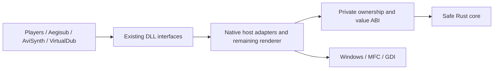

# Compatibility-first Rust migration

## Contract

The behavioral reference is pinterf/xy-VSFilter commit
`4911cacb102bc0cbd41449793e54473265b04e62`. All functionality remains in scope.
The target is a drop-in replacement in players, Aegisub and other existing hosts,
with bit-identical output. The repository itself defines ASS behavior; another
renderer or format description must not override it. Memory safety is the reason
for migration. A performance regression is acceptable. No deliberate semantic
cleanup is part of a port.

Preserve deterministic malformed-input results, parser recovery, byte and code
unit handling, integer truncation, timing boundaries, rounding, font metrics,
rendering order, caches' visible effects, and state across seeks. Keep externally
observable settings, interfaces, exports, identity and calling conventions.
Stable behavior implemented with unsafe C++ may need safe emulation in Rust.
Do not reproduce memory corruption. Crashes, hangs and unstable output are
unresolved reference outcomes requiring investigation, never matching results.

## What has been implemented

* Safe Rust owns `ReplaceNoCase` replacement/output construction after the
  original native lowercase call. It preserves source case outside replacements,
  leaves the needle's case untouched and never searches newly inserted text.
  Empty needles, embedded NULs or source-length changes during lowercase retain
  the native loop. Same-length caller mutations use fresh source data with the
  original lowercase snapshot.
  Fatal ASan/UBSan comparisons passed **288,330 calls** on arm64 and under x64
  execution: **178,951 changed strings**, **3,419,309 output UTF-16 units**,
  **4,047,187 callback observation values**, **12 interruptions**, **18 source
  mutations**, **46 source/argument aliases**, **288,049 Rust conversions** and
  **269 native fallbacks**. Every nonzero UTF-16 value, deletion/expansion,
  nonrecursive replacement and stable replacement-free NULs are covered.
  Nonterminating empty-needle and replacement-bearing NUL outcomes are excluded.
  Six SAMI scripts and an italic visible-change control expand the rendering
  corpus to **422 cases**. Rust 1.85 tests (84 core, 57 FFI), strict Clippy,
  default syntax, corpus freshness and Python harness checks pass. Windows/Miri
  and complete rendering validation are pending. Native lowercase, SAMI tag/color
  parsing, allocation failure timing and full host integration remain.
* Safe Rust owns `RemoveSSATags` text, brace-removal state and ordered text
  substitutions. Italic tags are converted before brace removal; the first
  charset-aware closing brace wins, an unterminated tail survives, and `\N`,
  `\n`, then `\h` substitutions run afterward. Native `FindChar` callbacks
  remain between owned mutations. Embedded-NUL replacement inputs retain the
  existing native path.
  Fatal ASan/UBSan comparisons passed **238,307 complete conversions** on arm64
  and under x64 execution: **233,048 changed strings**, **1,840,611 output UTF-16
  units**, **3,243,361 callback observation values**, **112 interruptions**,
  **238,051 Rust owners / 995,085 steps** and **256 stable native NUL fallbacks**.
  Nested/unclosed tags, every nonzero UTF-16 value and both charset-search modes
  are covered. Replacement-bearing NUL outcomes remain excluded. Rust 1.85 tests
  (83 core, 56 FFI), strict Clippy, default syntax and corpus freshness pass.
  Windows/Miri validation is pending. This helper is used by `GetStrW`/`GetStrWA`;
  the CSRI rendering corpus alone does not establish text-export compatibility.
  Input encoding conversion, allocation failure timing and full export/host
  integration remain separate work.
* Safe Rust performs MPL2's leading-slash and pipe-slash preprocessing, retaining
  native handling for embedded-NUL replacement inputs. It also implements the
  Unicode `FindChar` branch: searches start at the requested code-unit offset,
  stop at the next NUL, can match the implicit terminator, and reject a start at
  `GetLength` even when searching for NUL. Negative native starts retain the
  existing native path.
  Fatal ASan/UBSan comparisons passed **185,177 whole MPL2 conversions** on arm64
  and under x64 execution: **180,932 changed strings**, **3,563,191 output UTF-16
  units**, **8,633,053 callback observation values**, **199 interruptions**,
  **184,921 Rust preparations** and **256 stable NUL fallbacks**. Replacement-
  bearing NUL outcomes are excluded. The **487,996 scanner comparisons** now
  include **101,110 observed Rust Unicode searches**, and all **171,094 MicroDVD
  conversions** still match. Six MPL2 fixtures, including UTF-16 input and a
  visible italic control, expand the rendering corpus to **410 cases**.
  Rust 1.85 tests (81 core, 55 FFI), strict Clippy, default syntax and Python
  harness checks pass. Windows/Miri and whole-renderer validation are pending.
* Safe Rust owns MicroDVD conversion's line/tag state, output code units and
  style restore mask. The native adapter retains `FindChar`, `CStringW::Mid`,
  tag classification, case conversion, numeric scans and formatting. Unknown
  tags still drop the closing brace, a missing opening brace still uses the
  whole source length, charset tags still update the color restore bit, and
  restoration happens only at line separators in the original order.
  Fatal ASan/UBSan comparisons passed **171,094 complete conversions**, including
  **169,535 changed strings**, **5,860,113 output UTF-16 units**, **16,663,327
  callback observation values** and **611 injected interruptions**, on arm64
  and under x64 execution. All **171,094 conversions** used the Rust owner;
  **3,108,842 state steps** were observed. Every UTF-16 value, NUL tails,
  local/global overwrites, unknown/unclosed tags, empty/trailing lines and
  charset scans are included. Numeric fixtures assert successful scans and
  restrict arithmetic to representable results. Windows CI uses actual ATL/CRT;
  portable string/format models are preliminary evidence only. Rust 1.85 tests
  (79 core, 53 FFI), strict Clippy, default syntax and corpus freshness pass.
  Miri passed for `794d9609`; its initial Windows x64 portable comparison stopped
  with native process exit `0xc0000409` and no fixture diagnostic. Diagnostics
  in `f5d1ae8d` identified reference fixture 22, ordinary `{f:Arial}`: the test
  wrapper forwarded `Mid(start)` as `Mid(start, INT_MAX)`, unlike the real
  one-argument ATL overload. The wrapper now uses the exact overload. Neither
  failed run counts as passing evidence. The rerun at `91b97d13` then reached
  a reference/candidate output difference for embedded-NUL fixture 22310.
  Literal fragments now pass through the original native CString append boundary
  before being copied into the Rust-owned output, preserving its truncation
  semantics without treating the portable string model as authoritative.
  Corrected candidate `8e7b8522` passed both Windows portable jobs
  (x64 job `115709602067`, x86 job `115709602301`) and Miri (`115709601874`).
  Complete portable/rendering evidence is still pending. Fixture failure
  diagnostics and earlier text-adapter execution remain in the harness.
  Native tag conversion, input/line strings, allocation failure timing and host integration
  remain to be migrated or separately validated.
* Safe Rust owns the charset-aware `FindChar` loop used by MicroDVD and other
  text paths: lead-byte skipping, nested style depth, the original search offset,
  inline `\fe` digit scanning and empty charset reset. Native Windows code-page
  translation, lead-byte/digit classification, charset arithmetic and the Unicode
  `CStringW::Find` path remain in order. The native bridge ends each Rust input
  loan before classification or translation.
  Fatal ASan/UBSan comparisons passed **487,996 cases**, **5,002,990 native
  callbacks**, **623,221 translations** and **97 injected interruptions** on
  arm64 and under x64 execution; **386,883 Rust searches / 5,932,716 steps** were
  observed. Fixtures include every UTF-16 value, all 256 charset/byte pairs,
  embedded NULs, nested/empty charset tags and changing classification replies.
  Windows CI uses actual ATL and Windows charset APIs; local models do not
  establish those platform semantics. Native arithmetic fixtures are restricted
  to representable results. Eight MicroDVD scripts and an italic visible-change
  control expand the rendering corpus to **398 cases**. Rust 1.85 tests (77 core,
  52 FFI), strict Clippy, default syntax checks and Python harness checks pass.
  Candidate `21bea95d` passed all four portable platforms, Miri and both Windows
  DLL jobs, each matching **398 cases / 4,586 frames** and **32 mutations / 224
  frames**, including the new MicroDVD scripts and visible italic controls.
  Dialogs, exports and dependencies match, and both logs confirm Rust-enabled
  `STS.cpp` compilation. [Charset-search evidence](find-char-evidence.json) records
  verified hashes and stable local validation. This evidence predates the Unicode
  branch and converter increments above. Allocation failure timing and full
  host integration remain outside these comparisons.
* Safe Rust owns the UTF-16 text produced by caption `SaveDisp`, preserving
  spaces between nonempty fragments, row newlines, and bounded strings spanning
  row boundaries. Native timestamp truncation and subtitle insertion remain in
  order. The display loan ends before the owned result is copied to `CStringW`
  or any subtitle callback runs. Scans requiring data beyond the declared backing
  decline and are excluded from native parity; allocation failure timing remains
  unverified.
  Fatal ASan/UBSan comparisons passed **74,280 direct display conversions /
  6,715,023 UTF-16 units**, including **36 injected Add interruptions** and **36
  callback mutations**, on arm64 and under x64 execution. The complete caption
  oracle still passes **149,740 sequences / 170,720 DecodeCC calls**, with
  **78,850 Rust text selections and zero native fallbacks** across bounded cases.
  Rust 1.85 tests (75 core, 51 FFI), strict Clippy and default syntax checks pass.
  Candidate `830bd308` passed all four portable platforms, Miri and both Windows
  DLL jobs, each matching **382 cases / 4,490 frames** and **32 mutations / 224
  frames**, plus dialogs, visible controls, exports and dependencies. Both logs
  confirm Rust-enabled `CCDecoder.cpp` compilation. [Display evidence](cc-display-evidence.json)
  records verified hashes and stable local validation. Native display backing,
  subtitle sink and file/ripper interfaces remain separate integration work.
* Safe Rust owns the `DecodeCC` byte-loop state, character tables and command
  selection. Raw parity bytes are matched exactly; doubled controls consume both
  pairs and retain the second pair's timestamp index. Ignored controls, trailing
  bytes, transparent spaces and unusual extended-character dispatch are retained.
  Native cursor/display actions occur after each input loan ends, preserving
  source/backing aliases. Logging, display copies/clears, timestamp arithmetic
  and subtitle insertion remain native.
  Fatal ASan/UBSan comparisons passed **149,740 sequences / 170,720 `DecodeCC`
  calls**, plus **117 cursor moves** and **65,536 cell writes**, on arm64 and
  under x64 execution. They compare **4,209 subtitle records**, **340 injected
  Add interruptions**, **575 callback mutations** and **12,273 source/backing
  aliases**. Repeated and split calls cover empty/equal displays and retained
  caption state. The sink is a fixture; actual Windows ATL strings are used by
  CI. Native file I/O, unrepresentable arithmetic and caption-ripper integration
  remain outside these comparisons. Rust 1.85 tests (74 core, 50 FFI), strict
  Clippy and default syntax checks pass. Candidate `b998b021` passed all four
  portable platforms, Miri and both Windows DLL jobs, each matching **382 cases /
  4,490 frames** and **32 mutations / 224 frames**, plus dialogs, visible controls,
  exports and dependencies. Both logs confirm Rust-enabled `CCDecoder.cpp`
  compilation. [Command-loop evidence](cc-decoder-evidence.json) records verified
  hashes and stable local validation.
* Safe Rust normalizes closed-caption cursors and writes initialized cells in
  the original 16-by-33 backing. Columns at or beyond 32 advance only one row;
  rows at or beyond 16 wrap to zero. Negative coordinates clamp first. Each
  row's 33rd cell remains untouched, and native cursor advancement follows the
  Rust write. Unrepresentable cursor arithmetic declines to the existing path.
  Fatal ASan/UBSan comparisons passed **143,978 complete native `DecodeCC`
  calls**, **117 cursor moves** and **65,536 cell writes** on arm64 and under
  x64 execution: **528 emitted subtitle records**, **111 injected Add
  interruptions**, **270 callback mutations** and **8,432 source/backing aliases**.
  Every byte pair, doubled controls and every UTF-16 cell value are covered.
  The harness uses actual Windows ATL strings in CI, a portable UTF-16 string
  model locally, and a fixture subtitle sink. Raw logging/files, native integer
  overflow and actual caption-ripper integration are outside these comparisons.
  Rust 1.85 tests (73 core, 49 FFI), strict Clippy and default syntax checks pass.
  Candidate `9c6c3569` passed all four portable platforms, Miri and both Windows
  DLL jobs, each matching **382 cases / 4,490 frames** and **32 mutations / 224
  frames**, plus dialogs, visible controls, exports and dependencies. Both logs
  confirm Rust-enabled `CCDecoder.cpp` compilation. [Cursor/cell evidence](cc-cursor-evidence.json)
  records verified hashes and stable local validation. Command dispatch is
  covered by the later increment above; backing ownership and native subtitle/
  file integration remain to be migrated or separately validated.
* Safe Rust owns the outer `ParseRealText` document state machine. It preserves
  comment precedence, separate text/tag paths, start-before-end conversion,
  rendering before line insertion, history advancement afterward, open-before-
  close formatting actions, clear carry, window/center updates and final flush.
  A native adapter performs each requested action after the Rust input loan ends;
  the default build retains the pinned original method. Public result containers,
  CRT conversion, default-duration arithmetic and output streams remain native.
  Fatal ASan/UBSan comparisons passed **72,364 sequences / 86,020 complete
  parses** on arm64 and under x64 execution: **81,239 successful returns**,
  **1,981 malformed returns**, **4,825,097 native callbacks**, **2,800 injected
  interruptions** and **143,709,005 public-state observations**. State is checked
  at classification/conversion callbacks and after repeated parses, not only at
  successful completion. The separate 30,058 parser cases and 67,297 timing
  parses still pass. Rust 1.85 tests (72 core, 48 FFI), strict Clippy and both
  default syntax checks pass. Candidate `cc8b3093` passed all four portable
  platforms, Miri and both Windows DLL jobs, each matching **382 cases / 4,490
  frames** and **32 mutations / 224 frames**, plus dialogs, visible controls,
  exports and dependencies. Both logs confirm Rust-enabled `RealTextParser.cpp`
  compilation. [Document-loop evidence](realtext-document-evidence.json) records
  verified hashes and stable local validation. Native numeric
  overflow, allocation failure timing and full host integration remain outside
  this finite evidence.
* Safe Rust owns RealText's current-line and carried-open tag lists, including
  copied raw names, all four flags and ordered attribute keys/values. Closing
  removes only the last matching opener. Clearing replaces the current list
  with copies of the remaining open tags, in order. The native parser exports
  temporary tags for rendering and retains its public subtitle/window/font maps.
  Fatal ASan/UBSan comparisons passed **77,920 sequences / 575,478 list
  operations** on arm64 and under x64 execution, comparing **44,457,293 field
  observations** and **125,904 nonempty rendered snapshots**. The fixture shell
  uses native list operations and the actual pinned `PopTag`; it is complemented
  by **30,058 complete parser runs** and **67,297 timing-sequence parses**, all
  passing with the new owner active. Every UTF-16 value, duplicate names,
  simultaneous open/close flags, map ordering and expired native input copies
  are covered. Rust 1.85 tests (70 core, 47 FFI), strict Clippy and default syntax
  checks pass. Candidate `a0bde58b` passed all four portable platforms, Miri and
  both Windows DLL jobs, each matching **382 cases / 4,490 frames** and **32
  mutations / 224 frames**, plus dialogs, visible controls, exports and
  dependencies. Both logs confirm Rust-enabled `RealTextParser.cpp` compilation.
  [Tag-list evidence](realtext-lists-evidence.json) records verified hashes and
  stable local validation. Allocation failure timing
  and the remaining native public containers still require separate work.
* Safe Rust computes the signed components used by RealText `FormatTimecode`.
  It preserves truncation toward zero and the unusual divisor
  `10 * (3 - precision)`; the padding argument remains ignored. Native stream
  construction and insertion order preserve locale formatting, raw separators,
  partial output and stream failure behavior. Precisions with unrepresentable
  native intermediate arithmetic decline to the existing path and are excluded
  from reference-parity counts.
  Fatal ASan/UBSan comparisons passed **157,432 timestamps** and **2,992 complete
  `OutputSRT` calls** on each local architecture, including **726,304 numeric
  insertions**, **944 injected stream failures**, **636 live separator changes**
  and **43,104 flushes**. Cases include both signed INT boundaries, embedded NUL
  separators, custom locale grouping, caller stream flags and exception masks.
  All 100,064 tag-output cases and 30,058 complete parser runs still pass.
  Rust 1.85 tests (69 core, 46 FFI), strict Clippy and default syntax checks pass.
  Candidate `482a06ff` passed all four portable platforms, Miri and both Windows
  DLL jobs, each matching **382 cases / 4,490 frames** and **32 mutations / 224
  frames**, plus dialogs, visible controls, exports and dependencies. Both logs
  confirm Rust-enabled `RealTextParser.cpp` compilation.
  [Timestamp-format evidence](realtext-format-evidence.json) records verified
  hashes and stable local validation. Native stream and map ownership remains.
* Safe Rust owns RealText's start/end timing history and interval selection.
  Missing ends, non-increasing next starts, first-line insertion only into an
  empty map, explicit reversed intervals and final flushing retain their native
  rules. Default-duration addition and line-map writes remain native and occur
  before advancing the owned history. The outer parser and tag lists remain C++.
  Fatal ASan/UBSan comparisons passed **22,433 sequences / 67,297 complete
  parses** on arm64 and under x64 execution: **64,051 successful returns**, **3,070
  malformed returns**, **78,414 native insertion attempts**, **176 injected
  interruptions** and **1,610 live duration/map mutations**. The separate 30,058
  parser cases and 100,064 tag-output cases also pass. Fixtures constrain native
  arithmetic to representable values; overflow outcomes are not counted.
  Rust 1.85 tests (68 core, 45 FFI), strict Clippy and both default syntax checks
  pass. Candidate `40302134` passed all four portable platforms, Miri and both
  Windows DLL jobs, each matching **382 cases / 4,490 frames** and **32 mutations
  / 224 frames**, plus dialogs, visible controls, exports and dependencies. Both
  logs confirm Rust-enabled `RealTextParser.cpp` compilation.
  [Timing-history evidence](realtext-timeline-evidence.json) records verified
  hashes and stable local validation. Allocation failure timing for the
  owned history and native map still needs separate validation.
* Safe Rust owns `StringToLower` output and iteration state. Each raw UTF-16
  unit still passes through native `towlower`; neither Rust Unicode decoding nor
  a replacement case table is used. Source length is re-read after each native
  callback, so a shortened, extended or modified source behaves as before.
  Fatal ASan/UBSan comparisons passed **218,239 cases** on each local
  architecture across **three available locale selections**, including **203,036
  changed outputs**, **871,657 native conversions**, **67 injected interruptions**
  and **966 live input mutations**. Every UTF-16 value is compared within each
  available native locale; locale availability and counts can differ on CI.
  All 100,064 tag-output cases and 30,058 complete parser runs pass with the
  lowercase owner active. Rust 1.85 tests (67 core, 44 FFI), strict Clippy and
  default-branch syntax checks pass. Candidate `5b8fb1ed` passed all four
  portable platforms, Miri and both Windows DLL jobs, each matching **382 cases
  / 4,490 frames** and **32 mutations / 224 frames**, plus dialogs, visible
  controls, exports and dependencies. Both native logs confirm Rust-enabled
  `RealTextParser.cpp` compilation. [Lowercase evidence](realtext-lower-evidence.json)
  records verified hashes and stable local validation.
  Native allocation failure timing remains unverified.
* Safe Rust owns `ExtractString` text scanning and the text appended by
  `ExtractTextTag`. Leading whitespace still uses native classification. An
  initial `<` or empty input clears the output only when error recovery is on;
  reaching EOF after ordinary text appends that text, returns false and leaves
  the source untouched. Native append and source consumption retain their order.
  Identical source/output objects use the native fallback.
  Fatal ASan/UBSan comparisons passed **377,504 cases** and **20 terminating
  native alias cases** on arm64 and under x64 execution: **149,849 successful
  returns**, **137,659 changed inputs**, **479,593 whitespace operations**, **672
  injected interruptions** and **2,903 callback mutations**. Unterminated
  self-appending aliases are excluded. The integrated RealText oracle now also
  compares **30,058 complete parses**, including 10,000 three-call sequences
  reusing parser objects through successful and malformed documents. It checks
  persisted line maps and all window/font tag fields and center state.
  Rust 1.85 tests (66 core, 43 FFI), strict Clippy, corpus freshness and default
  syntax checks pass. Candidate `786752dd` passed all four portable platforms,
  Miri and both Windows DLL jobs, each matching **382 cases / 4,490 frames** and
  **32 mutations / 224 frames**, plus dialogs, visible controls, exports and
  dependencies. Both native logs confirm Rust-enabled `RealTextParser.cpp`
  compilation. [Text-extraction evidence](realtext-text-evidence.json) records
  verified hashes and stable local validation. Allocation failure timing remains
  unverified; this increment itself retained the native outer document parser.
* Safe Rust owns the `ExtractTag` state machine, including comments, prefix
  recovery, partial name/flag changes and source consumption. Comment names keep
  the leading `!`; a comment delimiter at EOF still returns false without
  consuming input. Existing tag names are appended to before native lowercasing,
  existing attributes survive, and the text flag is untouched. Native whitespace
  and lowercase callbacks see the same partial state. Their input changes and
  exceptions are preserved through short input loans and a noncopyable owner.
  Fatal ASan/UBSan comparisons passed **374,404 cases** on arm64 and under x64
  execution, including **231,469 successful returns**, **257,246 changed inputs**,
  **1,549,227 native operations**, **1,036 injected interruptions**, **1,216
  matching checked-string exceptions** and **3,018 callback mutations**. The
  100,064 tag-output comparisons and 58 complete parser cases still pass with
  all four RealText replacements. Rust 1.85 tests (65 core, 42 FFI), strict
  Clippy, corpus freshness and default-branch syntax checks pass. Candidate
  `41492b9e` passed all four portable platforms, Miri and both Windows DLL jobs,
  each matching **382 cases / 4,490 frames** and **32 mutations / 224 frames**,
  plus dialogs, visible controls, exports and dependencies. Both native logs
  confirm Rust-enabled `RealTextParser.cpp` compilation.
  [Tag-extraction evidence](realtext-tag-evidence.json) records verified hashes
  and stable local validation. Native allocation failure timing remains unverified.
* Safe Rust owns the reverse field extraction used by RealText `GetTimecode`.
  Empty components, embedded NULs, original unit order and the cached initial
  length are preserved; later numeric callbacks can still change unread input.
  A shortened input reaches the original native checked-string exception.
  Separator detection, fractional zero-padding, `_wtoi` and integer folding
  remain native. The original colon-only interpretation is retained: `1:2`
  produces 1,200 milliseconds.
  Fatal ASan/UBSan comparisons passed **364,136 cases** on arm64 and under x64
  execution, including **239,174 nonzero results**, **927,373 conversions**,
  **99 injected conversion interruptions**, **64 matching checked-string
  exceptions** and **280 callback-mutated inputs**. **1,425 fixtures outside
  representable native arithmetic** are excluded, not passing comparisons.
  The tag-output oracle and 58 complete native parses also pass with all three
  RealText replacements active. Rust 1.85 tests (64 core, 41 FFI), strict Clippy,
  corpus freshness and both default-branch syntax checks pass. Candidate
  `af1c5e1f` passed all four portable platforms, Miri and both Windows DLL jobs,
  each matching **382 cases / 4,490 frames** and **32 mutations / 224 frames**,
  plus dialogs, visible controls, exports and dependencies. Both native logs
  confirm Rust-enabled `RealTextParser.cpp` compilation.
  [Timecode evidence](realtext-timecode-evidence.json) records verified hashes
  and stable local validation. Native numeric arithmetic and allocation/OOM behavior
  remain outside this replacement.
* Safe Rust now owns the RealText attribute parser's names, values and cursor
  state. It retains missing-equals recovery, whitespace skipping even inside
  quotes, either quote ending a quoted value, raw NULs and duplicate map keys.
  Native whitespace classification, lowercasing and map assignments occur at
  their original checkpoints. The native cursor is published before each
  callback, and input is borrowed afresh afterward, preserving live changes.
  Fatal ASan/UBSan comparisons passed **153,946 cases** on arm64 and under x64
  execution: **101,814 successful returns**, **82,729 changed maps**, **1,187,159
  native callback operations**, **488 injected interruptions** and **772 live
  input mutations**. Failures compare partial maps and exact cursor positions.
  The tag-output oracle and **58 complete parser cases** also pass with both
  RealText replacements active. Rust 1.85 tests (63 core, 40 FFI), strict Clippy
  on both the pinned and current toolchains, and default-branch syntax checks
  pass. Candidate `e71d0945` passed all four CI platforms, Miri and both
  Windows DLL jobs, each matching **382 cases / 4,490 rendered frames** and
  **32 mutations / 224 frames**, plus dialogs, visible controls, exports and
  dependencies. Both logs confirm Rust-enabled `RealTextParser.cpp` compilation.
  [Tag-output and attribute evidence](realtext-tags-attributes-evidence.json)
  records verified hashes and stable local validation. Input/output allocation failures
  still need separate validation; native classification and map storage remain.
  This increment also corrects a Clippy 1.85 `needless_borrow` failure in the
  initial tag-output bridge: local checks had used a newer Clippy. Run
  `rustup run 1.85.0 cargo clippy --workspace --all-targets --locked --offline -- -D warnings`
  to match CI. Failed portable run `38508021393` is not counted as passing.
* Safe Rust owns RealText `RenderTags` output as raw UTF-16. It preserves tag
  precedence, the shared bold/italic ignore flag, both font open/close emissions,
  ordered unescaped attributes and suppression of formatting-only output.
  Native tag copies and map traversal remain in order. Windows `iswdigit` and
  `_wtoi` still classify/convert size attributes only when the original would;
  Rust applies the original range checks to their results. A noncopyable bridge
  releases the owned output after bounded scalar queries, including on native
  exceptions. No native string borrow survives a call.
  Fatal ASan/UBSan comparisons passed **100,064 tag-output cases / 2,280,955
  UTF-16 units** and **58 complete native parser runs** on arm64 and under x64
  execution. The oracle compares **205,389 classification/conversion observation
  values**, all ignore flags, unusual open/close/text combinations, size bounds
  and every UTF-16 code unit. Portable numeric conversion is a host model;
  Windows uses its actual CRT. Rust tests (62 core, 39 FFI), strict Clippy and
  both default-branch syntax checks pass. The renderer corpus now has **382
  cases / 4,582 scheduled frames**, including six RealText files and visible
  italic controls in file/memory modes. The corrected bridge and its composition
  with attribute parsing are validated on Windows x86/x64 and all portable CI
  platforms at `e71d0945`; see the shared evidence above.
  Parsing control flow, numeric conversion and native allocation/OOM behavior
  remain outside this replacement.
* Safe Rust recognizes the leading settings line removed by `WebVTTCueStrip`.
  It retains the five exact lowercase prefixes, first-newline lookup stopping
  at NUL, and refusal to strip an initial newline. The selected deletion ends
  before the newline; native `Delete` and `TrimLeft` preserve their order and
  actual Windows whitespace classification. There is no retained input borrow.
  Fatal ASan/UBSan comparisons passed **83,200 cases** on arm64 and under x64
  execution: **69,652 changed strings**, **139,334 native operations**, **60
  injected interruptions** and **602 strings changed between deletion and
  trimming**. Every post-newline UTF-16 code unit is compared. Windows uses
  installed ATL strings; portable trimming uses the host whitespace classifier,
  so comparisons are within each platform. Rust tests (61 core, 38 FFI), strict
  Clippy and both default-branch syntax checks pass. Candidate `431c9d50` passed
  all four CI platforms, Miri and both Windows DLL jobs. Each DLL job matched
  **370 cases / 4,430 frames** and **32 mutations / 224 frames**, plus dialogs,
  visible controls, exports and dependencies. Both logs confirm Rust-enabled
  `STS.cpp` compilation. [Cue-prefix evidence](webvtt-prefix-evidence.json)
  records verified hashes and stable local validation. This does not resolve
  the separate WebVTT insertion outcome or establish complete WebVTT host parity.
* Safe Rust owns the UTF-16 text produced by `SubRipper2SSA`, applying the six
  original case-sensitive italic/bold/underline replacements in their original
  order. The native public string interface remains unchanged; the source is
  not mutated, the charset argument remains ignored, and no Unicode decoding
  or case normalization is introduced. A noncopyable C++ owner queries bounded
  code units and releases the Rust result even if native string construction
  throws. Embedded-NUL inputs retain native replacement because the existing
  CString replacement evidence does not establish deterministic parity there.
  Fatal ASan/UBSan comparisons passed **121,163 cases / 2,703,506 UTF-16 units**
  on arm64 and under x64 execution, including **117,224 changed strings**,
  every nonzero code unit, malformed/nested fragments and a long repeated-tag
  case. Only stable tag-free NUL cases enter reference comparison; tag-bearing
  NUL cases are excluded. Windows uses installed ATL strings for the oracle.
  Rust tests (60 core, 37 FFI), strict Clippy and default-branch syntax checks
  pass. The renderer corpus now has **370 cases / 4,510 scheduled frames**, with
  eight new SRT files and visible italic/underline control pairs in file and
  memory modes. Candidate `db1f0e92` passed all four CI platforms, Miri and both
  Windows DLL jobs. Each DLL job matched **370 cases / 4,430 rendered frames**
  and **32 mutations / 224 frames**, plus the new visible controls, dialogs,
  exports and dependencies. Both logs confirm Rust-enabled `STS.cpp` compilation.
  [SubRip evidence](subrip-evidence.json) records verified source/DLL hashes,
  stable local validation and the exact fallback limits.
* Safe Rust selects DVD polygon-to-ASS commands and formats their signed decimal
  coordinates into a bounded UTF-16 buffer. Native public `CStringW` output,
  position/header formatting, prefix appends, final suffix and exception
  propagation remain in place. A grouped curve takes the next previous-command
  state from its **third consumed path type**, not the initial curve type;
  unknown types, close-figure-bit variants and incomplete triples retain the
  original empty-string append and state update. Point reads remain after the
  prefix append, and the last-type read remains after coordinate construction.
  Fatal ASan/UBSan comparisons passed **54,692 complete conversions** on arm64
  and under x64 execution, comparing **738,364 string operations**, **68 injected
  interruptions**, **7,314 callback-mutated paths**, **527 polygon rejections**
  and **303,997 Rust commands**. Fixtures cover every byte path type, mixed
  triples, signed coordinate limits and randomized coordinates. Windows uses
  installed ATL `CStringW` for native formatting and candidate assignment;
  the portable model uses `swprintf` and widens the Rust UTF-16 payload.
  Polygon generation is a fixture boundary, not an end-to-end fitting oracle.
  Native allocation sizes/OOM behavior remain unverified. Rust tests (59 core,
  36 FFI), strict Clippy and both default branch syntax checks pass.
  Candidate `9302624e` passed all four CI platforms, Miri and both Windows DLL
  jobs, each matching **354 cases / 4,334 frames** and **32 mutations / 224
  frames**, dialogs, visible controls, exports and dependencies. Both logs
  confirm Rust-enabled `VobSubImage.cpp` compilation.
  [DVD path evidence](vobsub-path-evidence.json) records verified source/DLL
  hashes, stable local validation and the formatting/backend boundaries.
* Safe Rust selects the split indices for DVD `SplitOutline`. It preserves the
  first strict maximum, preference for the first interior maximum on a tie,
  and 32-bit unsigned midpoint-index addition on both Windows architectures.
  Missing interior maxima retain the native assertion and continuation path.
  Native temporary-array construction, clearing of both outputs, paired
  appends and live midpoint-coordinate reads retain their original order.
  Fatal ASan/UBSan comparisons passed **72,408 complete calls** and **16,320
  table selections** on arm64 and under x64 execution, including **1,113
  matching assertions**, **490 append interruptions**, **3,286,335 temporary
  and output append attempts**, **13,468 input mutations during output appends**
  and **32,604 aliased-output cases**. There were **86,377 Rust selections**
  and **2,073 native fallbacks**. Short inputs leave existing outputs intact.
  Windows extracts the original Microsoft functional-cast spelling unchanged;
  portable extraction normalizes exactly three `unsigned int(...)` casts per
  method to `static_cast<unsigned int>(...)`, recorded in the report. Array
  operations are modeled; source/output aliasing and all-zero arbitrary run
  tables are excluded from reference parity. Rust tests (57 core, 35 FFI),
  strict Clippy and both default native branch syntax checks pass.
  Candidate `6b0c9a75` passed all four CI platforms, Miri and both Windows DLL
  jobs. Each DLL job matched **354 cases / 4,334 frames** and **32 mutations /
  224 frames**, dialogs, visible controls, exports and dependencies. Both logs
  confirm Rust-enabled `VobSubImage.cpp` compilation.
  [DVD split evidence](vobsub-split-evidence.json) records verified source/DLL
  hashes, stable local validation and extraction normalization.
* Safe Rust selects circular outline segments for `GrabSegment`, preserving
  zero-direction skipping, the first repeated direction, wrapped midpoint
  indices, signed coordinate rounding and the returned previous-corner index.
  Native output clearing and paired point/direction appends retain their order.
  Only the entries actually used by selection are read; unused native entries
  need not be initialized. Copying selected interior points remains live after
  append callbacks, and the original pre-append point count stays fixed.
  Local fatal ASan/UBSan comparisons passed **86,376 cases** on arm64 and under
  x64 execution, including **9,811 no-segment assertions**, **168 injected append
  interruptions**, **697,820 point/direction append attempts** and **2,344 input
  mutations during append callbacks**. There were **76,562 Rust selections** and
  **9,814 native fallbacks**. Tests compare ordered events, partial paired arrays,
  return values and mutated input. Unsupported counts, layouts and arithmetic
  retain native handling; container operations are modeled in the oracle.
  Rust tests (56 core, 34 FFI), strict Clippy and both default native branch syntax
  checks pass. Candidate `b8b3802f` passed all four CI platforms, Miri and both
  Windows DLL jobs, each matching **354 cases / 4,334 frames** and **32 mutations
  / 224 frames**, dialogs, visible controls, exports and dependencies. Both logs
  confirm Rust-enabled `VobSubImage.cpp` compilation.
  [DVD segment evidence](vobsub-segment-evidence.json) records verified source and
  DLL hashes, stable local validation and the remaining bitmap-host scope.
* Safe Rust creates DVD outline masks from alpha, finds the original zero-to-one
  starting transitions, and advances the integer outline walker. It preserves
  equality-to-one neighbor tests, marked-byte wrapping, point locations and turn
  order. Native outline allocation, append operations, top-left updates and
  diagnostics remain in place; declined steps leave the mask untouched before
  executing the original assertion path.
  Fatal ASan/UBSan tests passed **70,240 complete outline cases** and **131,220
  direct walk steps** on arm64 and under x64 execution. The full-loop fixtures
  cover every bordered 4x4 occupancy mask and compare **1,759,474 allocation,
  append and mask observations**, including **19 allocation refusals** and
  exact partial list/top-left results. Direct step fixtures cover **38,316
  matching native assertion paths**. There were **70,207 Rust mask fills**,
  **180,248 Rust start searches**, **1,421,618 Rust walk steps** and **38,316
  native fallback calls**. Container operations are modeled; this is not a
  proof of ATL container allocation behavior or polygon smoothing.
  Rust tests (55 core, 33 FFI), strict Clippy and both default native branch syntax
  checks pass. Candidate `f257e6d4` passed all four CI platforms, Miri and both
  Windows DLL jobs. Each DLL job matched **354 cases / 4,334 frames** and
  **32 mutations / 224 frames**, dialogs, visible controls, exports and
  dependencies. Both logs confirm Rust-enabled `VobSubImage.cpp` compilation.
  [DVD outline evidence](vobsub-outline-evidence.json) records the source and DLL
  hashes, stable local report and remaining scope. CSRI text rendering does not
  establish DVD host playback parity.
* Safe Rust implements the DVD `Scale2x` edge-filter arithmetic and traversal.
  The original method keeps the image dimensions unchanged. The Rust path
  preserves its five-neighbor equality tests, center-pixel substitution at
  edges, and packed-channel bias: blue/green receive rounding while red/alpha
  truncate. Native temporary allocation, allocation-exception timing, copy-back
  and deletion remain in their original order. Rust fills uninitialized output
  through an exclusive loan while borrowing disjoint initialized source words.
  Fatal ASan/UBSan tests passed **74,951 comparisons / 153,499,648 bytes** on
  arm64 and under x64 execution, including **68,256 visibly changed cases**,
  **143,749 observed allocations**, **18 injected allocation interruptions**
  and **143,731 Rust-filled images**. Tests compare two complete image/guard
  checkpoints, every equality assignment among five neighbors, channel pairs,
  rectangle/pointer state and allocation order. Rust tests (54 core, 32 FFI),
  strict Clippy and both default native branch syntax checks pass. Candidate
  `f1262add` passed all four CI platforms, Miri and both Windows DLL jobs. Each
  DLL job matched **354 cases / 4,334 frames** and **32 mutations / 224 frames**,
  plus dialogs, visible controls, exports and dependencies. Both logs confirm
  Rust-enabled `VobSubImage.cpp` compilation.
  [DVD trim/filter evidence](vobsub-trim-scale-evidence.json) records verified
  source/DLL hashes and scope for this increment and trimming below.
* Safe Rust DVD trimming scans only alpha bytes and builds bordered crops in
  owned storage. RGB bytes retain the native copy semantics without requiring
  initialization; the new border is zero-filled. Native rectangle inflation,
  intersection, final positioning and pointer selection remain in the adapter.
  Unsupported layouts, allocation refusal, source/output overlap and writes
  into the native object retain the original copy before any Rust output write.
  Local fatal ASan/UBSan comparisons passed **80,285 cases** on arm64 and under
  x64 execution, including every 4x4 alpha occupancy mask, repeated trimming,
  empty/reversed dimensions, **809 source/output alias cases** and **100
  protected-object cases**. There were **159,629 Rust bounds scans**, **16 native
  bounds fallbacks**, **144,856 Rust crop copies** and **243 native copy
  fallbacks**. Fixtures with overlapping individual native `memcpy` ranges are
  excluded from parity (91 cases); admitted whole-buffer aliases still test
  observable border-zeroing and row-copy order.
  The decode-loop oracle now uses the actual trimming implementation as well:
  **85,168 comparisons / 3,500,216 full state/pixel boundary observations** pass
  on both local architectures. Windows component tests use actual ATL rectangle
  operations for both oracles. Rust tests (53 core, 30 FFI), strict Clippy and
  default native branch syntax checks pass. Candidate `f1262add` passed Windows
  x86/x64 component and DLL tests, the other two CI platforms and Miri; see the
  [shared trim/filter evidence](vobsub-trim-scale-evidence.json). An earlier
  Windows oracle compile failure was corrected by using the rectangle types
  exposed globally by the installed ATL header; that failed run is not counted
  as passing evidence.
  Native image allocation, retained-buffer ownership and host playback remain.
* Safe Rust DVD nibble extraction and variable-length run-code decoding preserve
  each of the four stopping thresholds and the separate fill-to-end case. Values
  cross the C ABI one nibble at a time, retaining native read/draw interleaving
  when output overlaps upcoming input bytes. Offset updates, alternating-plane
  traversal, coordinate updates, allocation and trimming remain native.
  The extracted complete decode loop, nibble reader and drawing method passed
  **85,168 exact comparisons** on arm64 and under x64 execution with fatal
  ASan/UBSan. Tests compare **3,457,842 full state/pixel boundary observations**,
  including **222 injected native interruptions**, **8,000 input/output alias
  cases**, **842,868 Rust nibble calls** and **715,720 Rust code steps**. Every
  four-nibble prefix is covered; a control confirms that aliasing changes later
  consumed nibbles. Packet metadata, allocation and trim calls are observed
  substitutes in this loop oracle, not evidence for those implementations.
  Rust tests (52 core, 29 FFI), strict Clippy and both default native branch syntax
  checks pass. Candidate `d8df717e` passed all four CI platforms, Miri and both
  Windows DLL jobs. Each DLL job matched **354 cases / 4,334 frames** and
  **32 mutations / 224 frames**, plus dialogs, visible controls, exports and
  dependencies. Both logs confirm Rust-enabled `VobSubImage.cpp` compilation.
  [DVD run-code evidence](vobsub-rle-evidence.json) records verified source/DLL
  hashes and scope. The trimming increment above extends the loop oracle with
  actual trimming; packet metadata and allocation remain observed substitutes.
* Safe Rust DVD pixel-run clipping and filling preserve the original left-edge
  length retention, including runs ending exactly at the left edge, right-edge
  truncation, initial rejection order and pixel indexing. Palette reads remain
  native and finish before the exclusive output loan; each run uses one color
  snapshot, while later calls observe earlier writes to overlapping palettes.
  Output is write-only and may be uninitialized. Unsupported arithmetic/layouts
  retain native handling before any write.
  Fatal ASan/UBSan comparisons passed **913,647 cases / 1,871,149,056 bytes** on
  arm64 and under x64 execution. Both per-call checkpoints include the complete
  initialized fixture, with **473,623 visibly changed cases**, **607,744 palette
  alias cases**, **1,827,275 Rust-handled clipping calls**, **24 fallback calls**
  and **948,488 Rust-filled spans**. Rust tests (51 core, 29 FFI), strict Clippy
  and both default native branch syntax checks pass. Candidate `5aa90d84` passed
  all four CI platforms, Miri and both Windows DLL jobs. Each DLL job matched
  **354 cases / 4,334 frames** and **32 mutations / 224 frames**, plus dialogs,
  visible controls, exports and dependencies. Both logs confirm Rust-enabled
  `VobSubImage.cpp` compilation. [DVD pixel evidence](vobsub-pixels-evidence.json)
  records verified source/DLL hashes and scope. DVD RLE and trimming are separate
  increments above; native buffer ownership and bitmap-host playback remain.
* Safe Rust DVD/VobSub control-packet parsing returns patches for only the fields
  assigned by the original. It preserves inclusive rectangle coordinates,
  palette/transparency nibble order, 16-bit command-counter wrapping, forced
  flags, delay/current-time ordering, future-block stopping, unknown-command
  advancement, forward control targets and retained state across calls.
  The boundary reads only consumed initialized bytes and does not inspect old
  object fields that the packet would overwrite. Warning/assertion paths decline
  before applying a patch, preserving native diagnostic and partial-state order;
  packets aliasing the object retain native incremental reads and writes.
  Local fatal ASan/UBSan tests passed **304,134 exact comparisons** on arm64 and
  under x64 execution, including **965,093 state/diagnostic observations**,
  **526 injected diagnostic interruptions**, **4 object-alias cases**,
  **854,918 Rust-handled calls** and **56,690 fallback calls**. All palette and
  transparency words are covered, alongside timing, rectangle/offset, control
  target, counter-wrap and retained-state cases. Rust tests (49 core, 28 FFI),
  strict Clippy and both default native branch syntax checks pass. Candidate
  `5007763e` passed all four CI platforms, Miri and both Windows DLL jobs. Each
  DLL job matched **354 cases / 4,334 frames** and **32 mutations / 224 frames**,
  plus dialogs, visible controls, exports and dependencies. Both logs confirm
  Rust-enabled `VobSubImage.cpp` compilation.
  [VobSub packet evidence](vobsub-packet-evidence.json) records verified source/DLL
  hashes and scope. DVD RLE, buffer ownership and real bitmap-subtitle host
  playback remain separate work; the CSRI text corpus does not validate DVD playback.
* Safe Rust table-driven integer Gaussian accumulation owns initialized input,
  scratch and output storage. It preserves the original cumulative edges,
  asymmetric table traversal, skipped radius-zero first row/column, conditional
  rounding-state reset, unsigned wrapping and final byte narrowing. The boundary
  copies back the complete scratch state and active output rows without borrowing
  uninitialized native scratch or image padding.
  The Rust path requires nonnegative image stride, odd kernels matching their
  radii, sufficient dimensions (including the original upper-edge traversal),
  and mutable buffers disjoint from each other and coefficient tables. Unsupported
  layouts, arithmetic/table-index states and allocation refusal decline before
  native writes and retain the original implementation.
  Local fatal ASan/UBSan tests passed **93,184 comparisons / 6,106,906,624 bytes**
  on arm64 and under x64 execution, including **67,512 visibly changed images**,
  **7,168 image/scratch alias cases**, **87,552 Rust-handled calls** and **55,808
  fallback calls**. Tests compare the entire initialized fixture, including
  scratch state, guards and padding, across repeated and overlapping rows.
  Rust tests (47 core, 26 FFI), strict Clippy and default native branch syntax
  checks pass. Candidate `0ac9c3f9` passed all four CI platforms, Miri and both
  Windows DLL jobs. Each DLL job matched **354 cases / 4,334 frames** and
  **32 mutations / 224 frames**, plus dialogs, visible controls, exports and
  dependencies. Both logs confirm Rust-enabled `Rasterizer.cpp` compilation.
  [Integer-Gaussian evidence](gauss-integer-evidence.json) records verified
  source/DLL hashes and scope.
* Safe Rust byte-to-float conversion owns a complete output row and constructs
  the exact binary32 representation of each byte using integer arithmetic.
  It preserves positive-zero extension, source-row overlap and zero/overlapping
  destination strides for disjoint source/output spans. Only initialized active
  input rows are borrowed; output and pitch gaps are not. Source/output aliases,
  negative traversal and unsupported layouts retain their scalar/SSE native
  paths. The Windows x86 component oracle uses `/arch:IA32`.
  Local fatal ASan/UBSan tests passed **145,152 scalar comparisons** on arm64
  and **201,600 comparisons** under x64 execution, including **56,448 actual
  SSE comparisons**, **10,368 nearby/alias cases**, **77,238 Rust-handled calls**
  and **237,258 fallback calls**. All byte values and floating-point exception
  flags are checked; a control confirms scalar/SSE aliases can differ.
  Rust tests (46 core, 24 FFI), strict Clippy and default native branch syntax
  checks pass. Candidate `856eac29` passed all four CI platforms, Miri and both
  Windows DLL jobs; both logs confirm Rust-enabled `xy_filter.cpp` compilation.
  The DLL corpus now has **354 cases**, adding focused integer/fractional edge
  blur, Gaussian blur, combined/animated/clipped effects and alternate output
  geometry/orientation. Three new file/memory control pairs require visible
  differences from unblurred drawings. Each Windows DLL job matched **354 cases /
  4,334 frames** and **32 mutations / 224 frames**, plus dialogs, visible controls,
  exports and dependencies. [Byte-to-float evidence](byte-float-evidence.json)
  records verified source/DLL hashes and scope.
* Safe Rust float-to-float transposition handles disjoint positive-pitch
  layouts containing finite normal values or signed zeros. It moves initialized
  bit patterns through the same owned matrix storage as byte transposition;
  source/output padding is not borrowed. NaNs, infinities, subnormals, aliases,
  unusual layouts and allocation refusal retain native handling. SSE destination
  alignment is checked before using the Rust path. The Windows x86 component
  oracle explicitly uses `/arch:IA32`, matching the project's scalar build mode.
  Local fatal ASan/UBSan tests passed **343,260 scalar comparisons** on arm64
  and **463,800 comparisons** under x64 execution, including **120,540 actual
  SSE comparisons**, **18,000 nearby/alias cases**, **17,154 Rust-handled calls**
  and **687,726 fallback calls**. Tests compare all output bits and floating-point
  exception flags, including special-value fallback behavior. Byte transpose
  regression tests still pass. Rust tests (45 core, 23 FFI), strict Clippy and
  default native branch syntax checks pass. Candidate `7a81ca63` passed all four
  CI platforms, Miri and both Windows DLL jobs. Each DLL job matched **322 cases /
  4,026 frames** and **32 mutations / 224 frames**, plus dialogs, visible controls,
  exports and dependencies. Both logs confirm Rust-enabled `xy_filter.cpp`
  compilation. [Float-transpose evidence](float-transpose-evidence.json) records
  verified source/DLL hashes and scope; float-to-byte conversion remains native.
* Safe Rust byte-matrix transposition handles positive-pitch, non-overlapping
  layouts behind the existing switch. Native active source rows are copied into
  owned Rust storage; safe Rust transposes and adds the original zero extension.
  The boundary copies completed rows to writable output without borrowing its
  uninitialized contents or either buffer's pitch gaps. Overlapping buffers,
  unusual dimensions/pitches and allocation refusal retain the native path.
  Local fatal ASan/UBSan comparisons passed **218,043 cases / 1,786,208,256
  bytes** on arm64 and under x64 execution, including **83,818 visibly changed
  cases**, **16,200 nearby/alias cases**, **15,234 Rust-handled calls** and
  **320,052 fallback calls**. A control demonstrates that aliases require the
  original incremental read/write order. Nonterminating native traversal is
  excluded from parity counts. Rust tests (45 core, 22 FFI), strict Clippy and
  default native branch syntax checks pass; boundary tests use intentionally
  uninitialized pitch gaps and output. Candidate `2d4b8f8a` passed all four CI
  platforms, Miri and both Windows DLL jobs. Each DLL job matched **322 corpus
  cases / 4,026 frames** and **32 mutations / 224 frames**, plus dialogs, visible
  controls, exports and dependencies. Both logs confirm Rust-enabled
  `xy_filter.cpp` compilation. [Byte-transpose evidence](byte-transpose-evidence.json)
  records verified source/DLL hashes and scope. Float transposition is a separate
  increment above.
* Safe Rust weighted horizontal filtering covers fractional blur arithmetic
  behind the existing switch. Scalar full-width products and narrowing remain
  distinct from SSE word products and saturating additions. The original
  scalar zero/64 coefficient shortcuts, SSE coefficient snapshots, scalar-tail
  live coefficient reads and differing row traversal remain in native adapters.
  Inputs/results cross by value, including each eight-byte source snapshot, so
  coefficient aliases retain their original read/write order.
  Local fatal ASan/UBSan tests passed **34,371,920 scalar comparisons** on arm64
  and **68,709,280 comparisons** under x64 execution, including **34,337,360
  actual SSE comparisons** and **61,440 coefficient-alias cases**. For each
  normalized filter, tests exhaust all neighboring-byte sums, center bytes and
  rounding policies in full SIMD groups and scalar tails. Wider coefficients,
  boundaries, padding/guards and repeated overlapping rows are also compared.
  Nonterminating negative-height/negative-stride SSE states are excluded from
  parity counts. Rust tests (44 core, 20 FFI), strict Clippy and default native
  branch syntax checks pass. Candidate `47aecadf` passed all four CI platforms,
  Miri and both Windows DLL jobs. Each DLL job matched **322 corpus cases /
  4,026 frames** and **32 mutations / 224 frames**, plus dialogs, visible controls,
  exports and dependencies. Both logs confirm Rust-enabled `xy_filter.cpp`
  compilation. [Weighted-filter evidence](weighted-filter-evidence.json) records
  verified source/DLL hashes and scope.
* Safe Rust horizontal `[1, 2, 1]` filtering replaces the scalar and SSE
  arithmetic behind the existing switch. Each call lends one initialized row;
  later overlapping rows see earlier writes after the preceding borrow ends.
  All four original rounding expressions, zero-padded endpoints and repeated
  passes are preserved, including the nonstandard named half-to-even policy.
  The extracted oracle passed **67,221,760 comparisons** on arm64 and
  **134,443,520 comparisons** under x64 execution with fatal ASan/UBSan,
  including **67,221,760 actual SSE comparisons**. It exhausts all byte triples
  under every policy in a full eight-pixel SIMD group plus scalar tail, and
  covers padding, guards, width/alignment boundaries and negative/zero strides.
  Rust tests (43 core, 20 FFI), strict Clippy and both default native branch
  syntax checks pass. Candidate `37e4cd2a` passed all four CI platforms, Miri
  and both Windows DLL jobs. Each DLL job matched **322 corpus cases / 4,026
  frames** and **32 mutations / 224 frames**, plus dialogs, visible controls,
  exports and dependencies. Both logs confirm Rust-enabled `xy_filter.cpp`
  compilation. [Horizontal-filter evidence](be-filter-evidence.json) records
  verified source/DLL hashes and scope.
* Safe Rust fixed 3x3 blur column-state updates and pixel arithmetic, behind the
  existing switch for widths/heights of at least two. Native adapters retain
  one-byte scalar and eight-byte SSE source snapshots, output order, and the
  scalar tail's re-read of source bytes after SSE writes. This preserves the
  distinct results possible with overlapping rows. Rust borrows only the current
  bounded groups of two disjoint column-history buffers; input/output bytes cross
  by value. Native allocation and uncommon-dimension fallback remain in place.
  Local fatal ASan/UBSan tests passed **43,860 scalar comparisons** on arm64 and
  **87,720 comparisons** under x64 execution, including **43,860 actual SSE
  comparisons, 21,930 visibly changed cases and 360 injected allocation failures**.
  The oracle also compares allocation events, final column histories, padding,
  guards and the unused scratch argument across repeated passes and negative/zero
  stride. A reference-only control confirms scalar/SSE alias results can differ.
  Rust tests (42 core, 19 FFI), strict Clippy and default native branch syntax
  checks pass. Candidate `488b020a` passed all four CI platforms, Miri and both
  Windows DLL jobs. Each DLL job matched **322 corpus cases / 4,026 frames**
  and **32 mutations / 224 frames**, plus dialogs, visible controls, exports and
  dependencies. Both logs confirm Rust-enabled `Rasterizer.cpp` compilation.
  [Fixed-blur evidence](be-blur-evidence.json) records verified source/DLL hashes
  and scope.
* Safe Rust bilinear subpixel rows for horizontal/vertical factors zero through
  eight, behind the existing switch. The bridge lends one initialized byte row
  and its disjoint WORD column history at a time. Row borrows end before later
  overlapping rows; the Rust loop retains left-edge reset, column updates,
  rounding and byte narrowing. Native column allocation/zeroing/free and uncommon
  factors remain in place, including allocation failure and empty-row behavior.
  The extracted oracle passed **97,897 exact comparisons / 801,972,224 bytes**
  with fatal ASan/UBSan, including **53,046 visibly changed cases** and **256
  injected allocation failures**. It compares pixels, padding, guards, allocation
  events and final column history across all factor pairs, repeated shifts,
  negative/zero pitch and overlapping rows. Rust tests (41 core, 18 FFI), strict
  Clippy and default native branch syntax checks pass. Candidate `e75c1bf2`
  passed all four CI platforms, Miri and both Windows DLL jobs. Each DLL job
  matched **322 corpus cases / 4,026 frames** and **32 mutations / 224 frames**,
  plus dialogs, visible controls, exports and dependencies. Both build logs
  confirm Rust-enabled `Rasterizer.cpp` compilation.
  [Bilinear evidence](bilinear-evidence.json) records verified source/DLL hashes
  and scope.
* Safe Rust 32-bit MMX/SSE body/border mask arithmetic is prepared behind the
  same switch. Four-byte signed high-word mask products and sixteen-byte
  unsigned products remain distinct. Native adapters preserve the original
  first-row alignment thresholds across all rows, byte/four-byte/sixteen-byte
  input snapshots and final MMX-state cleanup. All inputs and results cross the
  C ABI by value; Rust does not borrow native input or output storage. Broader
  opacity states retain the native fallback.
  Portable scalar/Win64-delegation tests passed **533,992 comparisons** with
  fatal ASan/UBSan. A supplementary x64 execution of the Win32 source branch
  passed **34,088,424 comparisons**, including **33,554,432 explicit group-size
  byte-triple comparisons**. That supplementary run uses Clang MS extensions
  for the original pointer narrowing and disables alignment instrumentation for
  x86 unaligned loads; it is not a Win32 ABI result. Candidate `9febb4eb`
  subsequently passed all four CI platforms, Miri and both Windows DLL jobs.
  Each DLL job matched **322 corpus cases / 4,026 frames** and **32 mutations /
  224 frames**, plus dialogs, visible controls, exports and dependencies.
  Both build logs confirm Rust-enabled `Rasterizer.cpp` compilation.
  [SIMD-mask evidence](simd-mask-evidence.json) records verified source/DLL
  hashes and scope. Rust tests (39 core, 17 FFI) and strict Clippy pass.
* Safe Rust scalar body/border alpha-mask arithmetic, with and without clip
  masks, is prepared behind the same switch. Signed rounding and final byte
  wrapping are preserved. Native code retains row traversal and buffer access;
  the C ABI passes only scalar bytes/opacity and returns a byte, avoiding a Rust
  borrow of output that may not yet have been initialized. Broader opacity
  values outside the proven signed-intermediate range keep the native fallback.
  This also reaches the 64-bit renderer through its existing scalar delegation;
  32-bit MMX/SSE mask generation remains native at this stage.
  The portable extracted oracle passed **268,496 exact comparisons /
  1,099,759,616 bytes**, including **239,304 visibly changed cases**, with fatal
  ASan/UBSan. It covers byte combinations, signed opacity, buffer/mask aliases,
  strides and defined fallback cases. Rust tests (38 core, 16 FFI), strict
  Clippy and default native branch syntax checks pass. Candidate `1de3623d`
  passed all four CI platforms, Miri and both Windows DLL jobs. Each component
  job passed **268,496 mask comparisons**. Each DLL job matched **322 corpus
  cases / 4,026 frames** and **32 mutations / 224 frames**, plus dialogs,
  visible controls, exports and dependencies. Both build logs confirm Rust-enabled
  `Rasterizer.cpp` compilation. [Scalar-mask evidence](scalar-mask-evidence.json)
  records verified source/DLL hashes and scope.
* Safe Rust single-pixel scalar/SSE blending and scaled shape/clip-alpha
  arithmetic are prepared behind the same switch. SSE signed-word weights,
  bitwise weight construction, logical shifts and saturation remain distinct
  from the scalar packed arithmetic for wider alpha values. Native pixel loads
  and stores remain at the boundary; the new C ABI takes and returns scalars.
  The scalar adapter retains its original body for the small signed-setup
  overflow range, which is excluded from parity counts. The extracted x64
  oracle passed **71,764,938 exact comparisons** with fatal ASan/UBSan: all byte
  channel/alpha combinations, wide-alpha boundaries and deterministic full-width
  values, plus byte and wider shape/clip products. Existing row/rectangle tests
  also pass with these helpers enabled. Rust tests (37 core, 16 FFI), strict
  Clippy and default C++ branch syntax checks pass. Candidate `76fa23c8`
  passed all four CI platforms, Miri and both Windows DLL jobs. Each Windows
  component job passed **71,764,938 single-pixel comparisons**. Each DLL job
  matched **322 corpus cases / 4,026 frames** and **32 mutations / 224 frames**,
  plus dialogs, visible controls, exports and dependencies. Both logs confirm
  Rust-enabled `Rasterizer.cpp` compilation. [Single-pixel evidence](single-pixel-evidence.json)
  records verified source/DLL hashes and the retained fallback scope.
* Safe Rust additive packed blending and variable-alpha planar blending are
  prepared behind the existing opt-in switch. Additive colors saturate upward
  while inverse alpha saturates downward. The bridge retains the SSE alpha
  snapshots, planar alignment prefixes/tails and row order. New extracted
  comparisons include all byte combinations, overlaps between masks and output,
  overlapping rows, negative/zero source and destination pitch and controls
  proving that grouped reads can differ from scalar reads.
  Local x64 fatal ASan/UBSan comparisons passed **467,520 Release cases** and
  **746,720 original-Debug-branch cases**, the latter including **279,200 masked
  planar comparisons**. The pinned planar helper's Clang Release build differs
  from its original Debug branch even on a zero-alpha fixture. The harness
  therefore excludes that helper from Clang Release parity counts and records
  the Debug build separately; Windows MSVC Release remains the production
  reference. No failed comparison is counted as passing. Rust tests (36 core,
  16 FFI) and strict Clippy pass. Candidate `0f149c4c` passed all four CI
  platforms, Miri and both Windows DLL jobs. Each Windows component job passed
  **746,720 fill comparisons**, including **279,200 masked planar comparisons**
  against the original MSVC Release branch. Each DLL job matched **322 corpus
  cases / 4,026 frames** and **32 mutations / 224 frames**, plus dialogs,
  visible controls, exports and dependencies. Both logs confirm Rust-enabled
  `Rasterizer.cpp` compilation. [Additive/planar evidence](additive-planar-evidence.json)
  records the source/DLL hashes and the distinct reference build scopes.
* Safe Rust constant-alpha packed/planar row blending and variable-alpha packed
  blending, behind the existing opt-in switch in `Rasterizer.cpp`. This preserves
  the original alpha-plus-one weighting, truncation and inverse-alpha channel.
  Native adapters retain row/plane order and snapshot the SSE path's 16 alpha
  bytes before borrowing its destination. Scalar calls preserve per-pixel read
  timing, including when alpha overlaps the destination; the two paths can have
  intentionally different results in those cases.
  The extracted oracle compares both original paths against their own candidate,
  including all channel/alpha byte combinations, SIMD boundaries, padding,
  guards, strides, overlapping rows/planes and overlapping alpha. Local x64
  emulation with fatal ASan/UBSan passed **303,688 exact comparisons /
  587,090,944 bytes**, including **10,560 rectangles** and **273,115 visibly
  changed cases**. arm64 reports this SSE-dependent component as unavailable.
  Candidate `15c45bed` passed all four CI platforms, Miri and both Windows DLL
  jobs. Each x86 component run passed **303,688 exact comparisons**. Each DLL
  job matched **322 corpus cases / 4,026 frames** and **32 mutations / 224
  frames**, plus dialogs, visible controls, all export tables and dependencies.
  Both build logs confirm Rust-enabled `Rasterizer.cpp` compilation.
  [Pixel blend evidence](pixel-blend-evidence.json) records the verified source
  and DLL hashes and exact scope. Native surfaces, broader compositing and
  allocation remain to port.
* Safe Rust scalar transitions for `CGolombBuffer::BitRead` requests from zero
  through 32 bits while the cached bit count is below 64. The bridge preserves
  the pre-EOF shift, peek refills, masking and residual-bit counts. Native code
  retains the byte storage, per-byte position/count updates and the wider or
  unusual-state fallback. This adds no Rust owner or borrowed native slice;
  the internal C ABI returns a struct of scalar values. The public reader class
  and its layout are unchanged.
  The harness now extracts separate reference and candidate reader classes and
  runs candidate HDMV/DVB renders through the candidate reader. A standalone
  operation oracle also compares peeks, resets, alignment, skips, size changes,
  buffer copies, input mutations and complete signed/unsigned Exp-Golomb codes.
  Candidate `221c8b24` passed **1,117,618 exact reader operations** locally
  and on all four CI platforms, plus Miri and both Windows DLL jobs. The native
  comparisons matched **322 corpus cases / 4,026 frames** and **32 mutations /
  224 frames** on each architecture, including dialogs, exports and dependencies.
  [Reader transition evidence](golomb-evidence.json) records the source and DLL
  hashes and confirms Rust-enabled `GolombBuffer.cpp` compilation. Buffer
  ownership and the retained wider-read path still need migration.
* Safe Rust DVB field dispatch for `CompositionObject::DvbRenderField`, behind
  the existing opt-in switch. The native reader still supplies logical positions
  and bytes; Rust selects the pixel decoder, preserves signed field lengths,
  requests mapping-table skips and tracks alternate-row coordinates. Mapping
  skips and pixel strings are not clamped to the declared field end. Line markers
  restore the starting X and narrow Y after adding two. Native pixel decoders
  retain their coordinate references during drawing, and return updated values
  before Rust resumes. Unknown type bytes keep the native assertion/release
  behavior. No native callback runs inside a Rust frame.
  A new extracted oracle covers actual `RenderDvb` and `DvbRenderField` bodies
  together with the three pixel decoders, including shared top/bottom cursors,
  negative lengths, prebuffered bits, skipped mappings, dirty rectangles, palette
  changes and injected exceptions. x86 pixel cases use the original SSE fillers
  for both packed and planar buffers, comparing all padding and guards.
  The full local suite passed with fatal ASan/UBSan: **253,887 field
  comparisons / 9,545,490 native observations**, including **164,958 injected
  boundary exceptions**. Rust tests (30 core and 12 FFI) and strict Clippy pass.
  The default C++ path was also syntax-checked for arm64 and x64. Windows x86/x64
  component runs passed **284,607 field comparisons / 12,116,250 observations**,
  including **195,438 injected exceptions, 30,720 exact native pixel comparisons
  and 240 visibly drawing fixtures** per architecture. Candidate `9dff4fc6`
  passed [all four CI platforms and Miri](https://github.com/CoffeeFlux/xy-VSFilter/actions/runs/38476034205)
  and [both Windows DLL jobs](https://github.com/CoffeeFlux/xy-VSFilter/actions/runs/38476034214).
  Each DLL job matched **322 corpus cases / 4,026 frames**, plus **32 mutations /
  224 frames**, warning dialogs, visible controls, all three export tables and
  declared dependency requirements. Both logs confirm the Rust-enabled
  `CompositionObject.cpp` compilation. [DVB field evidence](dvb-field-evidence.json)
  records source inputs, paired DLL hashes, successful jobs and exact scope.
  RLE ownership, bitmap packet parsing and host playback remain native/unverified
  by this component oracle.
* Safe Rust DVB 2-, 4- and 8-bit pixel-code-string decoding. Rust requests the
  original bit/byte reads and returns runs; native code retains coordinate
  references, per-mode width checks, palette lookup, drawing, `UnionRect` and
  final `BitByteAlign`. The 4-bit path keeps its disabled width check; the other
  two still check even zero-count/quit runs. Explicit zero-length 8-bit runs
  still consume their palette and continue. Native coordinate updates remain
  after drawing and dirty-rectangle updates, including aliased x/y references.
  The oracle extracts all three actual reference/candidate methods and uses
  the pinned native bit reader. Windows uses the real `UnionRect`; other
  platforms use a documented stand-in. It observes reader state, requests,
  coordinates, dirty rectangles, palette changes and injected exceptions,
  including reused readers with peeked or partially consumed bytes. As with
  HDMV, packed and planar pixel cases use the original SSE fill methods on x86.
  Local macOS arm64 validation passed **414,004 comparisons / 7,905,374
  native observations**, including **152,467 injected boundary exceptions**,
  under fatal ASan/UBSan. The local x64-emulated run also passed **440,180
  comparisons / 8,123,934 observations**, including **176,979 injected
  exceptions, 26,176 exact native pixel comparisons and 1,664 visibly drawing
  fixtures**. Combined candidate `a0d3ab3f` passed
  [all four CI platforms and Miri](https://github.com/CoffeeFlux/xy-VSFilter/actions/runs/38471876844).
  Both Windows architectures and Linux produced the same HDMV/DVB observation,
  exception and pixel-comparison counts as the local x64 run. The arm64 runner
  compares state/requests; it does not substitute a scalar pixel filler for SSE.
  The combined candidate also passed [Windows x86/x64 DLL validation](https://github.com/CoffeeFlux/xy-VSFilter/actions/runs/38471876823):
  **322 cases / 4,026 frames** per architecture (310 successful opens and 12
  matching open rejections), plus **32 mutations / 224 frames**. Warning-dialog
  observations, font/drawing controls, all three DLL export tables and declared
  dependency requirements match. Both build logs show `CompositionObject.cpp`
  compiled with the Rust adapter enabled. [Bitmap-run evidence](bitmap-run-evidence.json)
  records the exact source inputs, reference method hashes, reports, DLL hashes,
  successful job links and the separate component/CSRI validation scopes.
  The DVB packet parser and its buffer ownership remain native; the later
  field-dispatch increment is described above.
* Safe Rust HDMV run-decoding state for `CompositionObject::RenderHdmv`.
  An opaque owner requests the original EOF/byte reads and rectangle draws in
  order. Transparent runs, implicit palette zero, zero-length line advances,
  truncated switch/length/palette reads and signed 16-bit coordinate wrapping
  are retained. Palette lookup occurs at each native draw, without caching a
  copied palette. No native callback or exception unwinds through a Rust frame.
  RLE backing storage, `CGolombBuffer`, palette conversion, rasterization and
  DVB packet parsing remain native; field dispatch and pixel-code strings are covered above. This is a decoder-state port, not a bitmap buffer
  ownership or packet-parser port.
  The extracted original/candidate methods passed **483,497 comparisons /
  8,317,084 EOF/byte/draw observations** on macOS arm64 with fatal ASan/UBSan,
  including **3,798 injected boundary exceptions**. A local x64-emulated run
  also exercised the exact original packed/planar SSE pixel-fill methods:
  **499,597 comparisons / 8,540,584 observations**, including **19,298 injected
  exceptions, 16,100 exact pixel comparisons and 600 visibly drawing fixtures**.
  Extreme/malformed coordinate cases compare draw requests without calling the
  pixel fillers; pixel cases use bounded surfaces and compare padding/guards too.
  Candidate `4963c9d0` passed [all four CI platforms and Miri](https://github.com/CoffeeFlux/xy-VSFilter/actions/runs/38470714683).
  Combined-candidate DLL validation is recorded above. The existing CSRI
  corpus remains a text-rendering regression check; it does not exercise HDMV
  stream parsing or host-driven bitmap playback. The new files retain the
  reference component's GPL-3.0-or-later terms; workspace package metadata now
  reflects that requirement, with existing file notices preserved.
* Safe Rust computes the incremental segment edits in
  `CSimpleTextSubtitle::Add`. Rust owns a snapshot and computes ordered split,
  gap-fill and entry-insertion operations. The native adapter applies these to
  the existing arrays, preserving readorder shortcuts, animation flags, native
  copy/insertion order and partial state at injected storage-call exceptions.
  Entry preparation, first-entry insertion, string/style processing and native
  array storage remain native. The extracted tail passed **59,215 comparisons /
  1,453,819 mutation snapshots**, including **3,357 injected boundary exceptions**,
  in the final local sanitizer run. Eight SubRip fixtures expand the corpus to
  **322 cases** and exercise this bridge during native parsing. File opening
  rebuilds segments afterward, so the extracted oracle, rather than final CSRI
  frames alone, establishes intermediate insertion-state compatibility.
  The candidate explicitly handles WebVTT end-of-list insertion. This case is
  checked against candidate invariants and excluded from differential counts
  because its reference outcome is unresolved. Candidate `320069fc` passed
  [all four platforms and Miri](https://github.com/CoffeeFlux/xy-VSFilter/actions/runs/38466508664)
  with identical insertion counts, including the final native adapter index checks.
  It also passed the [regular Windows x86/x64 DLL campaign](https://github.com/CoffeeFlux/xy-VSFilter/actions/runs/38466508568):
  **322 cases / 4,026 frames** per architecture (310 successful opens and 12
  matching open rejections), plus **32 mutations / 224 frames**. Warning-dialog
  observations, font/drawing controls, all three DLL export tables and declared
  dependency requirements match. All eight new SubRip fixtures produce visible
  output through both file and memory opening.
  The larger seed-`20261019` campaign also matched **256 mutations / 1,792
  frames** per architecture, plus the same full corpus, in the
  [x86 job](https://github.com/CoffeeFlux/xy-VSFilter/actions/runs/38466766844/job/115535455468)
  and [x64 job](https://github.com/CoffeeFlux/xy-VSFilter/actions/runs/38467187846/job/115536920655).
  An assembler download timeout required retrying x64 setup; no renderer
  comparison failed in that setup attempt. [Incremental timeline evidence](incremental-timeline-evidence.json)
  records the exact successful jobs, source inputs, reports, DLL hashes and
  visible fixture output. Entry sorting and frame/time conversion remain native.
* Safe Rust `CSimpleTextSubtitle::CreateSegments`:
  breakpoint sorting, interval construction, temporary segment/entry storage,
  empty-range removal and original entry order. Even inactive zero-duration and
  reversed entries retain their breakpoint effects; adjacent equivalent segments
  are not merged. A scalar-only private owner returns the completed segments to
  the existing native array, preserving `animated=false` and the native
  `OnChanged`/logging calls. The extracted original and candidate methods passed
  **205,982 exact segment comparisons** locally with fatal ASan/UBSan, including
  callback snapshots, cached-state replacement and extreme signed timestamps.
  Eight new ASS fixtures expand the DLL corpus to **306 cases**, sampling every
  timeline boundary in both directions. Candidate `74439b37` passed all four
  platforms and Miri in [CI](https://github.com/CoffeeFlux/xy-VSFilter/actions/runs/38450833335).
  It also passed [Windows x86/x64 DLL validation](https://github.com/CoffeeFlux/xy-VSFilter/actions/runs/38450833303):
  **306 cases / 3,274 frames** per architecture, plus 32 mutations / 224 frames.
  All three DLL export tables and declared dependency requirements match.
  [Segment-builder evidence](segment-builder-evidence.json) records the reports,
  source inputs, DLL hashes and visible timeline-fixture output. The incremental
  `Add` edit port is described above; sorting of native entries and time
  conversion remain native.
* The three timeline lookup algorithms (`SearchSub`, `SearchSubs`, `SearchSubs2`)
  now have safe Rust state machines. The native adapter performs each requested
  timestamp translation in the original order, so CRT/frame-rate rounding stays
  native and exceptions cannot unwind through a Rust frame. Gap behavior,
  equality shortcuts, empty-list output indices and aliased output pointers are
  retained. The extracted methods passed **1,051,947 exact local comparisons**
  under fatal ASan/UBSan, including **14,352 injected translation exceptions**.
  Actual native translation bodies are retained in the oracle; finite frame
  rates, negative frame rates, invalid mode values, unsorted/reversed timelines
  and extreme integer times are covered. Inputs large enough to overflow native
  signed array-index arithmetic and native OOM behavior remain unverified.
  Candidate `aa2e1997` passed [all four platforms and Miri](https://github.com/CoffeeFlux/xy-VSFilter/actions/runs/38451614498)
  with the same lookup/exception counts. The combined segment-builder/search
  port passed [Windows x86/x64 DLL validation](https://github.com/CoffeeFlux/xy-VSFilter/actions/runs/38451634396):
  **306 cases / 3,274 frames** per architecture (294 successful opens and 12
  matching open rejections), plus **256 mutations / 1,792 frames** using seed
  `20261018`. Warning-dialog observations, font/drawing controls, all three DLL
  export tables and declared dependency requirements match. Every new timeline
  fixture produces visible output. The [regular 32-mutation campaign](https://github.com/CoffeeFlux/xy-VSFilter/actions/runs/38451614349)
  also passed on both architectures, including the same full corpus and another
  224 mutation frames. [Combined timeline evidence](timeline-evidence.json)
  records source inputs, reports, DLL hashes and fixture observations. These
  passing cases do not resolve the older seed-20261017 native exception or the
  allocation-dependent drawing replacement; both remain recorded below.
* A dependency-free Cargo workspace. `rust/compat` forbids unsafe Rust and uses
  only `core`/`alloc`. The production Windows static library uses `native-runtime`
  to avoid pulling in Rust std's newer Windows dependencies. A small allocator
  adapter uses the DLL's existing CRT `_aligned_malloc`/`_aligned_free` pair.
* A safe port of `CTextFile::NextChar`, including its nonstandard UTF-8 behavior,
  raw UTF-16 code units, error statuses and cursor movement.
* Safe Rust ownership of the text reader's 4 KB buffer and decoded line, including
  refill/compaction, CR/LF handling, surrogate output, malformed-input fallback
  and EOF cursor state. Native file reads, seeks, BOM detection and logging remain
  in a small adapter. The adapter borrows the fixed Rust buffer only during a
  native read; no Rust frame is active when an MFC exception can occur. The
  extracted C++ oracle now checks **37,008 file scenarios / 1,396,467 line/seek
  comparisons**, including **6,096 injected read exceptions**, short reads,
  repeated EOF, reopening, encoding changes and diagnostic ordering. This new
  component passed local fatal ASan/UBSan, Miri and all four portable CI jobs.
  Candidate `022da3c4` also passed [Windows x86/x64 renderer validation](https://github.com/CoffeeFlux/xy-VSFilter/actions/runs/38425799685)
  on the expanded 210-case corpus plus 32 mutations, with matching exports and
  no added imports/changed platform headers for all three DLLs. A separate
  [256-case mutation campaign](https://github.com/CoffeeFlux/xy-VSFilter/actions/runs/38425941551)
  also passed on both architectures. The corpus produced **1,982 frames** and
  the larger mutation campaign **1,792 frames** per architecture.
  [Reader-stage evidence](text-reader-evidence.json) records report and DLL hashes.
* Safe Rust font-attachment decoding, preserving byte truncation of arbitrary
  UTF-16 units, invalid lengths and short tails. The same opt-in build property
  enables this component. GDI font installation remains native.
* Safe Rust ASS command/parameter tokenization. Empty tags, non-nesting
  parentheses, comma/backslash recovery and raw code units are retained. Native
  `iswspace` supplies classifications to preserve CRT/locale behavior.
* Safe Rust drawing command state and temporary path storage. Empty moves,
  incomplete Bezier groups, spline rollback/fallthrough, closure and validity
  checks follow `CPolygon::ParseStr`. Native `GetPOINT`/`wcstod`, numeric
  tracing, scaling and downstream rasterization remain intact. Tokenization is
  covered by the next increment below.
  The extracted command-state oracle passed **343,183** comparisons of path
  types, coordinates, validity, cache bypass and point-request order, using
  identical supplied token/point results. Fatal ASan/UBSan, all four portable
  CI jobs and Miri passed. Candidate `30ff4447` passed the [Windows x86/x64
  renderer comparison](https://github.com/CoffeeFlux/xy-VSFilter/actions/runs/38427593488):
  **240 cases / 2,282 frames** per architecture, plus 32 mutations / 224 frames.
  Font and drawing controls passed; all three DLL export tables and declared
  dependency requirements still match. A separate [256-case / 1,792-frame
  mutation campaign](https://github.com/CoffeeFlux/xy-VSFilter/actions/runs/38427818278)
  also passed on both architectures with another seed.
  [Combined-stage evidence](drawing-state-evidence.json) records the reports,
  native build logs, source inputs and all DLL hashes.
  [Portable tests and Miri](https://github.com/CoffeeFlux/xy-VSFilter/actions/runs/38427593494)
  passed for this same candidate.
* Safe Rust drawing token splitting and left trimming after the original seven
  native replacements. Raw UTF-16 units, embedded NULs and literal `*` separators
  are retained. The extracted oracle compares this boundary with real ATL on
  Windows. The revised boundary passed **1,342,183** comparisons on all four
  platforms, including Windows x86/x64, plus Miri and local fatal ASan/UBSan.
  Full DLL validation of the combined drawing/field increment is recorded below.
  **Preprocessing remains native:** an attempted replacement port exposed
  allocation-dependent ATL results for `mmm\0mm`. Two evaluations in one process
  produced different trailing command units. This is unresolved reference
  behavior, not a passing comparison or a safe emulation target. See
  [captured Windows evidence](drawing-replacement-unresolved.json). The prior
  local replacement stand-in incorrectly assumed ordinary substring semantics;
  it has been removed. Numeric parsing also remains native.
* Safe Rust `TryNextStr` and `GetStr` field scanning. `TryNextStr` trims only
  ASCII spaces; `GetStr` consumes classifications from the native CRT to retain
  locale behavior. Both preserve empty fields, embedded NUL handling, delimiter
  mutation and repeated reads of an undelimited final field. `GetStr` also
  preserves buffer mutation before throwing on an empty trimmed field. Native
  adapters keep the original string storage; Rust borrows bounded code-unit
  copies and returns offsets. Numeric conversion remains in the Windows CRT.
  Both functions passed the [four-platform CI and Miri run](https://github.com/CoffeeFlux/xy-VSFilter/actions/runs/38445306389):
  **5,713,464 comparisons per function** on Windows x86/x64, and **4,927,032 per
  function** on macOS/Linux with fatal ASan/UBSan. The oracle compares raw units,
  mutated buffers, returned pointer/field, next cursor and exceptions.
  Candidate `130cfea7` passed the [Windows x86/x64 DLL comparison](https://github.com/CoffeeFlux/xy-VSFilter/actions/runs/38445306418):
  **290 cases / 2,522 frames** per architecture, with 278 successful opens,
  12 matching open rejections, four matching warning-dialog interactions, and
  passing font/drawing controls. The 32-case / 224-frame mutation run passed;
  all three DLL export tables and declared dependency requirements match.
  [Combined evidence](drawing-and-fields-evidence.json) records source inputs,
  reports, DLL hashes and exact warning/control text with scripted responses.
  A separate [256-case campaign](https://github.com/CoffeeFlux/xy-VSFilter/actions/runs/38445381552)
  matched **255 cases / 1,785 frames** per architecture; one case raises a Windows
  exception in both baseline repeats and the candidate. That campaign remains
  **failed**, with its [unresolved evidence](native-exception-20261017.json) and
  exact reproducer preserved. No original exception is counted as compatibility.
* Value-only internal C ABIs for the character and attachment decoders. The ASS lexer
  has a separate, documented ownership boundary: it borrows two bounded input
  arrays during scanning, retains only integer spans, and returns an opaque owner
  whose destructor runs in Rust. A noncopyable C++ RAII wrapper owns it. No Rust
  allocation is freed by C++, and query results contain only integers.
  The buffered reader has its own noncopyable owner and a documented, bounded
  mutable borrow for native file I/O; its line storage stays private to Rust.
  The drawing owner accepts commands and coordinates by value and returns path
  types/coordinates by value; no pointer to its vector escapes Rust.
* An opt-in `RustTextDecoder=true` native build property. The original public DLL
  interfaces are retained. The default build still uses the original C++ code.
* A differential test that extracts the exact original method and UTF-8 helper
  header from the pinned Git commit, compiles them, and calls the real Rust ABI.
  It checks **85,992,064** cases: return values AND consumed bytes. This includes
  all 256 possibilities for each UTF-8 tail byte, not merely valid Unicode.
  A second oracle extracts the original `LoadFont` decoding block and compares
  **17,371,137** cases against the candidate block through its actual C ABI.
  The ASS lexer oracle extracts its original scanning block unchanged and
  compares commands, parameters, ordering and empty tags; it uses real ATL
  strings on Windows and storage stand-ins elsewhere. The local macOS run checks
  **2,793,355** cases with fatal ASan/UBSan; counts vary with available CRT locales.
* An isolated-process CSRI comparison harness, an exact-byte corpus generator,
  PE export/ordinal comparison, and a gate against added normal/delay imports or
  changed declared OS/subsystem requirements.
* CI for macOS, Linux and Windows x86/x64 leaf/bridge tests. These jobs do not
  build or validate the complete legacy renderer.
* A separate Windows renderer workflow builds all three native DLLs
  from separate pinned-reference and candidate checkouts, compares exports, and
  runs the real CSRI corpus. See Actions for the latest result; a build failure or
  incomplete run is not compatibility evidence. The earlier foundation candidate
  `7c45fc12`, containing
  all three components and the CRT-only runtime, passed on **Windows x86 and
  x64**: all three DLL export tables match and no normal/delay imports were added.
  Each architecture passed **186 CSRI cases / 1,758 frames**, including successful
  embedded-font controls, plus two mutation campaigns: **32 cases / 224 frames**
  and **256 cases / 1,792 frames** with different seeds. [Regular run](https://github.com/CoffeeFlux/xy-VSFilter/actions/runs/38362034452),
  [larger mutation run](https://github.com/CoffeeFlux/xy-VSFilter/actions/runs/38362090425).
  [Compatibility evidence](compatibility-evidence.json) preserves counts,
  toolchains, report hashes and the six DLL hashes for each architecture/run.
  All four portable jobs and Miri also [passed](https://github.com/CoffeeFlux/xy-VSFilter/actions/runs/38362034486).

The migration is an initial set of components and validation tools, not a finished
safe renderer. The rest of the native parsing, font handling, rendering,
other buffer management and host integration remains C++. There is no whole-renderer
compatibility or memory-safety claim yet.

## Migration shape

Keep the existing native projects and host adapters while replacing internals
behind a private C ABI. Consumers continue loading the same DLLs and public
interfaces. Rust modules follow responsibilities (`text`, `font`, `ass_tags`);
they do not need to reproduce every C++ class or directory. Retain a small
reviewable native change per component and a pinned, independently built oracle.



Portable algorithms and their differential tests can be developed on macOS.
Windows remains necessary for MFC, COM, GDI, DLL linking and actual host behavior;
the new CI already handles paired builds and CSRI rendering remotely. The local
Windows handoff is primarily for real application integration, debugger work,
and environments such as Windows 7 or specific font/locale/CPU configurations.

For each next component: isolate its real C++ code, capture its state and error
semantics, port into bounded Rust storage, compare at the internal boundary,
then compare complete DLL output. Move ownership of untrusted buffers into Rust
as components grow. Tiny arithmetic ports alone do not remove native lifetime
hazards. Keep production opt-in until wider host and malformed-input evidence
supports changing the default.

## A concrete quirk already preserved

The UTF-8 branch of `NextChar` only validates the leading byte and available
length. It masks subsequent bytes with `0x3f` even when they are not continuation
bytes. For example, `c2 41` produces `0x81`, `ed a0 80` produces the raw surrogate
`0xd800`, and `f4 bf bf bf` produces `0x13ffff`. The latter is handled later by
`ReadLine`, not by this decoder. A rejected lead consumes one byte; an incomplete
sequence consumes none. Rust strings or `char` would lose this behavior.

The attachment decoder also accepts code units outside the usual encoded-font
alphabet: it subtracts 33, truncates to a byte, and then masks bits. The port
preserves that behavior. Its Rust bulk API validates the output slice before
writing; the temporary C++ adapter retains allocation and packs four input units
at a time into a value-only ABI. The native adapter's loop bounds still require
review; no pointer is dereferenced inside Rust.

## Local validation

Python 3.10+, a C++ compiler, Git history containing the pinned commit, and Rust
are sufficient. The CI toolchain is Rust 1.85.0; local reports record the actual
compiler. No Cargo registry downloads are needed by the workspace.

```sh
cargo test --workspace --locked --offline
cargo clippy --workspace --all-targets --locked --offline -- -D warnings
cargo fmt --all --check
python3 tools/compat/check_decoder.py --sanitize
python3 -m unittest discover -s tools/compat -p 'test_*.py' -v
python3 tools/compat/make_corpus.py --check
```

The decoder report goes to `artifacts/decoder/<target>/report.json` and records
the reference commit, source hashes, compiler and result. The native tests
extract original algorithm blocks without modifying their logic. Storage and
file-I/O stand-ins surround those blocks. The drawing-state oracle supplies
identical pre-tokenized inputs and point results; its separate lexical oracle
tests `Tokenize`/`TrimLeft` against real ATL strings on Windows, starting with
initialized post-replacement buffers. Native command replacement is outside that
oracle because of the unresolved allocation-dependent behavior above. The field
oracle compares six consecutive calls, mutated buffers and both pointer offsets.
The segment oracle checks the full native arrays and callback snapshots. Timeline
search tests compare returned pointers, nullable/aliased output parameters,
translation call traces and injected native exceptions. The incremental-insertion
oracle extracts the prepared-entry timeline tail of `Add`, including its native
readorder assignment. It compares entry metadata, segment endpoints and ordered
entries, animation flags, each outer native `Copy`/`Add`/`InsertAt` call and state
after injected call-boundary exceptions. Windows uses real ATL arrays; other
platforms use the documented storage stand-in. It does not claim to reproduce
allocation failure inside array relocation or to test entry text/style preparation.
The ASan/UBSan run instruments the C++ side;
it does not instrument the Rust static library. Safe Rust is enforced in the
core by a compiler lint. The ASS lexer, text reader, drawing, segment, timeline
search and bitmap decoder FFI owners and the production CRT
allocator contain unsafe Rust, for constructing borrowed slices,
querying/releasing owned results, lending the fixed read buffer to native I/O,
and allocating/deallocating aligned storage.
Every unsafe block states its caller contract. The native caller copies its
inputs into typed vectors and bounds output spans by the original string length.
Miri checks the Rust-side ownership lifecycle in a separate CI job. Windows unit
tests also check the CRT allocator's alignment, zeroing and reallocation. Native
out-of-memory behavior and concurrent changes to the process locale have not
been established as compatibility guarantees.

The same command also compares the text-reader operations: **37,008
file scenarios and 1,396,467 line/seek comparisons**, including **6,096 injected
read exceptions**. It compares diagnostics, native read requests, cursor/count,
encoding and output, including retries after a read writes a byte then throws. Original and candidate BOM
detection, refill, line handling, logical positions and seeking are extracted
from their actual source files; only MFC's underlying file reads/seeks are replaced
by an in-memory test file. This exercises malformed sequences around 4096-byte
boundaries and encoding fallback. The complete MFC/Windows file path still needs
native integration coverage.

Harness tests compile a deliberately fake native CSRI library, exercise the real
ctypes ABI and subprocess machinery, and inject byte changes, crashes, hangs,
rejections and buffer overwrites. Passing these tests validates the harness,
not VSFilter's output.

## Windows handoff

The workflow `.github/workflows/native-compat.yml` is the executable build recipe
already used on Windows runners. It pins YASM and its required VC2010 runtime
with checksums. Use it when reproducing the setup locally; installing a newer
Visual C++ runtime alone does not provide `MSVCR100.dll` for that assembler.

Once the prerequisites below are installed, the combined runner builds both
trees, checks exports/imports, and runs the smoke, corpus and mutation comparisons:

```powershell
git worktree add --detach ..\xy-VSFilter-reference 4911cacb102bc0cbd41449793e54473265b04e62
pwsh -File tools/compat/run_native_comparison.ps1 -Platform x64 -Baseline ..\xy-VSFilter-reference -MutationCount 32
# Run from an x86 Native Tools prompt with x86 Python:
pwsh -File tools/compat/run_native_comparison.ps1 -Platform Win32 -Baseline ..\xy-VSFilter-reference -MutationCount 32
```

To repeat the larger incremental-timeline campaign, use
`-MutationCount 256 -MutationSeed 20261019` on the same command and give each
architecture a fresh `-Output` directory. This runs the full checked-in corpus
before the generated mutation cases; it does not replace the extracted intermediate-state tests.

Use PowerShell 7 (`pwsh`) for the combined runner. Evidence goes to
`artifacts/native/x64` and `artifacts/native/Win32`; an existing destination is
rejected. For subsequent runs supply a new `-Output` directory. Build reports
record both commits, toolchain versions, dirty-tree status and the tracked-source
patch. A dirty/untracked working tree is not established by the commit ID alone;
commit source changes before producing release evidence. CI uploads reports,
build logs and all three reference/candidate DLLs. To replay downloaded mutation
artifacts, restore their `candidate/artifacts/native/...` tree under this checkout's
`artifacts/native/...`, preserving the manifest's relative fixture paths.

1. Clone `https://github.com/CoffeeFlux/xy-VSFilter.git`, fetch all history, and
   check out `rust/compatibility-foundation`.
2. Use separate baseline and candidate worktrees/build directories. The baseline
   must be the pinned commit above, without the Rust branch's code changes.
   Use the same Visual Studio toolset, SDK, Release configuration, architecture,
   Windows installation, fonts, locale and settings for each pair. Preserve the
   binaries and record their hashes. Do not mix x86 and x64 binaries.
3. Install Visual Studio C++ build tools including MFC/ATL, the Windows SDK,
   and the YASM integration needed by the original projects. The existing
   `build_vsfilter.sh` and `.github/workflows/build.yml` document the historical
   VS2019 build; `src/configuration.props` also selects v143 for VS2022. The
   legacy workflow uses old Actions/runner versions, so don't assume it still
   works unchanged. Restore a baseline build before interpreting port failures.
4. Install Rust's MSVC targets:

   ```powershell
   rustup target add x86_64-pc-windows-msvc i686-pc-windows-msvc
   ```

5. In the appropriate VS Native Tools prompt, run the leaf differential test:

   ```powershell
   python tools/compat/check_decoder.py --target x86_64-pc-windows-msvc
   # Repeat in an x86 compiler environment:
   python tools/compat/check_decoder.py --target i686-pc-windows-msvc
   ```

6. Build the candidate Rust library, then rebuild the native solution with the
   experimental property. Start with x64; repeat for Win32:

   ```powershell
   powershell -File tools/compat/build_rust_windows.ps1 -Platform x64
   msbuild VSFilter.sln /m /t:Rebuild /p:Configuration=Release /p:Platform=x64 /p:RustTextDecoder=true
   ```

   The Rust library uses a static CRT to match `/MT`. Debug integration is
   intentionally rejected until its runtime configuration is validated. The
   build script prints `native-static-libs`; check the list against the native
   link configuration when changing Rust versions. Rebuild all dependent native
   libraries after changing the property; existing objects are not trustworthy
   when switching implementations.

   `src/common.props` targets Windows 7 (`WINVER=0x0601`). Modern Rust's regular
   Windows std targets require Windows 10, so production uses `core`/`alloc` and
   the existing native CRT instead. The C++ bridge requires a link marker from
   this configuration, rejecting an accidentally linked std build. The native
   workflow rejects added imports and changed PE OS/subsystem fields. These
   checks do **not** establish Windows 7 or older-CPU support: run the binaries
   on those environments before release, checking code generation and dynamic
   API loading too. [Rust's Windows baseline change](https://blog.rust-lang.org/2024/02/26/Windows-7/),
   [MSVC aligned-allocation contract](https://learn.microsoft.com/en-us/cpp/c-runtime-library/reference/aligned-malloc).

7. Compare exports for every shipped DLL, including the consumer when built:

   ```powershell
   python tools/compat/pe_exports.py C:\baseline\VSFilter.dll C:\candidate\VSFilter.dll
   python tools/compat/pe_exports.py C:\baseline\XySubFilter.dll C:\candidate\XySubFilter.dll
   ```

8. Run original-vs-original first, then original-vs-candidate. Python must have
   the same architecture as the DLL. Output directories must be new:

   ```powershell
   python tools/compat/csri_compare.py --reference C:\baseline\VSFilter.dll --candidate C:\baseline\VSFilter.dll --output artifacts\reference-x64 --environment-label "Win-build/toolset/fonts/settings"
   python tools/compat/csri_compare.py --reference C:\baseline\VSFilter.dll --candidate C:\candidate\VSFilter.dll --output artifacts\candidate-x64 --environment-label "Win-build/toolset/fonts/settings"
   ```

9. Investigate every mismatch or unstable reference before enabling the port by
   default. Smoke-test actual Aegisub loading and rendering, DirectShow playback,
   AviSynth and VirtualDub. Add automated host-specific coverage as those seams
   become accessible. CSRI alone cannot validate the complete product.

## CSRI corpus and evidence

`test/compat/cases.json` contains 322 cases: both file and memory
loading for 34 existing ASS samples and 126 generated samples, plus geometry and
stride cases. Generated cases include malformed tags, duplicate tags, malformed
UTF-8, unpaired UTF-16, embedded NUL, CR/LF differences, missing final newlines
and the original 4096-byte refill boundary. Timeline fixtures cover overlapping,
duplicate, zero-duration and reversed events, layer ordering, gaps, equal starts
and ends, and repeated forward/backward seeks at one-tick boundaries.
The eight SubRip fixtures exercise incremental insertion with overlaps,
out-of-order cues, gap filling, nesting, touching intervals, duplicates, empty
text and zero/reversed durations, including a UTF-16 input. The direct insertion
oracle separately compares intermediate state before file opening rebuilds it.
`.gitattributes` prevents checkout
from changing any test bytes. Font cases include invalid encoded lengths/raw
UTF-16 units and a valid, pinned Abel font attachment. The unmodified font and
its SIL Open Font License are in `test/compat/fonts`; `source.json` records its
origin and hashes. A separate drawing/control pair verifies that the valid
spline fixture contributes visible output in both renderers. Attached/attachment-free
font controls must produce different
pixels in both builds, establishing that loading the font affects rendering.
Run those controls on a machine without Abel already installed. A control failure
is explicit and cannot pass merely because both renderers use the same fallback.
Run `make_corpus.py` to regenerate, or `--check`
to verify. Do not rewrite old fixtures to make a test pass.

Timestamps sample the first recognizable event's boundaries, midpoint and
backward seeks. This is deliberately a starter corpus: it does not cover all
events, animations, historical issue-specific timestamps, formats or host paths.
Sampling times are configuration, not a specification of how ASS is parsed.
Grow coverage using real scripts and minimized mismatch reproducers.

Each case gets fresh reference processes (at least two) and a fresh candidate
process, but retains one renderer instance for its entire timestamp sequence.
Some malformed files invoke the original renderer's modal warning for an unknown
style. Fixtures can declare `dialog_actions` containing an exact title, text
prefix and `ok`/`cancel` response. A Windows observer is restricted to the worker's
rendering thread, records dialog/control text, IDs, styles and the selected
response, then clicks only a matching scripted button. The complete captured
records are compared along with pixels. Unexpected dialogs still time out;
missing planned dialogs fail the harness. Dedicated Windows x86/x64 tests verify
these failures, successful scripted responses and warning-text mismatches. Icon handles are never compared as
text, and this does not validate dialog icon pixels or real host UI behavior.
The original [four field-fixture timeouts](field-dialog-timeouts.json) are retained
as unresolved evidence from before this interaction was scripted.

The complete destination allocation, including row padding and the fourth byte,
is initialized identically before each render and compared without tolerance.
Frame output is compared byte-for-byte; canaries detect nearby writes outside
the destination. Canaries are not a replacement for a sanitizer.

Reports include DLL and corpus hashes, case definitions, exact IEEE timestamp
bits, frame hashes, rejection statuses and first differing byte offsets. Failed
cases retain raw frames. Equal cases drop raw frames by default to save space;
`--keep-equal-frames` preserves all of them. Reports are checkpointed as cases
finish and only marked complete at the end. Crashes, timeouts, guard corruption,
harness errors and unstable reference output fail the run. A run with no rendered
frames cannot pass. Stable matching open rejections are recorded explicitly.

On Windows, reports also capture exported names/ordinals, OS, pointer width,
locale/code pages, hashes of files in system/per-user font directories, and a
read-only snapshot of `HKCU\Software\Gabest`. A change in that environment during
the run fails the comparison. Font registrations outside those directories,
system rasterizer versions, external files, host state and private fonts need
additional provenance as coverage grows. Keep baseline/candidate `.properties`
and localization sidecars identical and document them in the environment label.
The recorded reference commit identifies the intended source; the harness cannot
prove which source produced an arbitrary DLL. Archive build logs with binaries.

One source-level CSRI trap: `csri_request_fmt` accepts BGR32, BGR24, YUY2 and
YV12, but `csri_render` implements only BGR32 and otherwise displays a dialog and
enters invalid arithmetic. The harness records format-query results but only
renders BGR32. This mismatch is recorded, not silently "corrected" or mistaken
for implemented pixel-format coverage.

## Mutation runs and mismatch reduction

`mutate_corpus.py` adds deterministic byte edits to combinations of ASS tags,
with UTF-8/BOM/raw UTF-16 variants. It records the seed, generator version,
operations and hashes. This is a bounded mutation campaign, not coverage-guided
fuzzing or exhaustive malformed-input coverage. Native CI adds 32 cases with
seed 12345 after the checked-in corpus; manual workflow runs can select another
seed and count. A reference crash remains a failure to investigate.

```powershell
python tools/compat/mutate_corpus.py --seed 12345 --count 64 --output artifacts\mutations
python tools/compat/csri_compare.py --reference C:\baseline\VSFilter.dll --candidate C:\candidate\VSFilter.dll --cases artifacts\mutations\cases.json --output artifacts\mutation-results --timeout 10 --environment-label "local Windows mutation run"
```

For a mismatch whose reference runs agree, reduce the exact input bytes without
rewriting the source fixture:

```powershell
python tools/compat/reduce_case.py --reference C:\baseline\VSFilter.dll --candidate C:\candidate\VSFilter.dll --case artifacts\mutation-results\case-00000\case.json --output artifacts\reduced --max-attempts 100
```

Every trial repeats the reference and checks the failure category. A crash,
timeout, guard violation or unstable reference cannot replace a pixel mismatch.
The reducer checkpoints the best input, case manifest, binary hashes and trial
results, and retains initial/best frame evidence. Its report distinguishes
finishing the reduction from exhausting the attempt budget. Re-run the final
`cases.json`, inspect its raw bytes, then add it as a regression fixture. The
reducer does not handle unresolved native crashes yet; keep those original inputs
for a Windows debugger/sanitizer run. Native harness tests inject a real byte
mismatch and verify reduction, while rejecting equal outputs and crashes.

### Preserved native exception from mutation seed 20261017

The 256-case campaign found one unresolved Windows exception in both reference
runs and the candidate: `mutation-01352899-00172`. The other 255 cases matched.
The [exact fixture and one-case manifest](../test/compat/unresolved/cases.json)
and [original exception evidence](native-exception-20261017.json) are retained.
It contains `\bord23456`; excessive border allocation is a hypothesis to
investigate, not an established cause. The initial report's last stage was
`close`, but cleanup could have overwritten an earlier failure. The harness now
records `failure-before-close.json` and Python tracebacks before cleanup; Windows
tests inject a native exception during rendering to verify that this context
survives. The [diagnostic replay](https://github.com/CoffeeFlux/xy-VSFilter/actions/runs/38445381552)
locates the first exception in `csri_render` at timestamp `1` (frame index 1),
before cleanup, on Windows x86 and x64 in both reference repeats and the candidate. It does not
identify the internal native throwing function. Exceptions remain unresolved even
if both implementations raise them.

Replay this case separately with the real Windows DLLs; it is deliberately not
included among the passing fixtures, and the original 256-case campaign remains
failed rather than being relabeled as a success:

```powershell
python tools/compat/csri_compare.py --reference C:\baseline\VSFilter.dll --candidate C:\candidate\VSFilter.dll --cases test/compat/unresolved/cases.json --output artifacts\unresolved-native-exception --timeout 10
```

## Verifying downloaded evidence

`tools/compat/summarize_evidence.py` verifies downloaded artifact reports, paired
DLL hashes, export/dependency checks, dialogs and visible timeline controls.
It checks all four portable platforms against the same candidate/reference,
and compares recorded source-input hashes with that Git commit, allowing only
checkout line-ending conversion. It refuses to overwrite existing evidence or
run with Python assertions disabled. Incomplete or failed reports cannot produce
a summary. Miri and workflow job status must also be checked in GitHub; the
artifact verifier does not query GitHub itself.

The portable runner snapshots candidate inputs and the commit before extraction
and compilation, then checks both again before marking a report complete. It
rejects changed files, newly added harness/Rust inputs, or a changed HEAD. Keep
the checkout stable throughout validation; commit source changes first. Local
runs with edits still have content hashes, but the evidence summary only accepts
hashes matching the recorded commit.

Download artifacts under `artifacts/ci-RUN` using the artifact names as
subdirectories. For example, after both workflows finish:

```sh
gh run download 38471876844 --dir artifacts/ci-38471876844
gh run download 38471876823 --dir artifacts/ci-38471876823
python tools/compat/summarize_evidence.py a0d3ab3fec7dafbc2dc300721c82f2066827f29d 38471876844 artifacts/verified-bitmap-evidence.json 38471876823
```

Use `RUN/Win32` or `RUN/x64` when selecting a successful architecture job from
a workflow whose other job did not complete. This never relabels that workflow
as successful. The checked-in summaries additionally record reviewed job links
and the validation scope for each increment.

## Coverage map and remaining migration

| Surface/subsystem | Reference locations | Required evidence still missing |
| --- | --- | --- |
| DirectShow/COM, registration, property pages, autoload | `DirectVobSubFilterDll.cpp`, `DirectVobSub*.h`, `auto_load_helper.cpp` | CLSIDs/IIDs, vtables, HRESULTs, refcounts, graph negotiation, threading, registration/unload, player tests |
| XySubFilter and consumer | `xy_sub_filter*.cpp`, `include/SubRenderIntf.h`, `XySubRenderIntf.h` | Provider/consumer negotiation, frame ownership, options and lifecycle |
| Aegisub/CSRI | `csri.h`, `csriapi.cpp` | Broader DLL corpus, open flags/extensions, longer lifecycle sequences and real Aegisub integration; see the recorded component-stage corpus results above |
| AviSynth | `plugins.cpp`, `vfr.cpp` | Exact `VobSub`, `TextSub`, `TextSubSwapUV`, `MaskSub` signatures/defaults, frame properties, timing, pixel formats, MT behavior |
| VirtualDub | `plugins.cpp`, bundled SDK headers | Export calling conventions, filter negotiation, scripting, RGB orientation, lifecycle |
| Text formats | `STS.cpp`, `TextFile.cpp`, `RealTextParser.cpp`, `USFSubtitles.cpp`, `libssf` | SSA/ASS, SubRip variants, SubViewer, MicroDVD, SAMI, WebVTT, VPlayer, XombieSub, USF, MPL2, RealText and SSF parsing/recovery |
| Timeline and event ordering | `STS.cpp`, `STS.h` | Segment construction, incremental edits and lookup have differential tests; native entry preparation/storage/sorting, frame/time conversion and host-driven mutation/lifecycle sequences still need migration and broader integration coverage |
| Bitmap subtitles | `VobSub*`, `HdmvSub*`, `DVBSub*`, `CompositionObject*`, `CCDecoder*` | HDMV/DVB run states, DVB field assembly and DVD control-packet parsing have extracted oracles; RLE buffer ownership, remaining packet assembly, DVD pixel decoding, PGS/SUP and DVB host playback, closed captions and external file behavior remain |
| Layout/rendering | `RTS.cpp`, `Rasterizer.cpp`, caches, overlay/clip code | Every tag's recovery and interaction, drawings, clipping, transforms, karaoke, blur/border/shadow, GDI/font metrics and fallback |
| Compositing/color | `subpic`, SIMD/assembly, conversion tables | All RGB/YUV formats, high bit depths, interlace/subsampling, pitch/orientation, alpha and rounding |
| Supporting behavior | `dsutil`, `decss`, vendored libraries, settings | Encodings, code pages, font attachments, file/network access, archive inputs, persistence and remaining unsafe dependencies |

Continue portable migration here while Windows CI checks each native bridge.
Local Windows work includes actual Aegisub/player loading and the host coverage
above. Useful next port boundaries include numeric parsing in `STS.cpp`
and the remaining command replacement/numeric parsing in `CPolygon`. Numeric conversion
must preserve the Windows CRT's overflow, locale, end-pointer and float-rounding
behavior; substituting Rust's string parsers is not justified. The drawing code
also has non-obvious recovery and truncation behavior to capture before porting.

Concrete boundaries that can be developed on macOS, with Windows CI supplying
the native oracle where needed:

| Next boundary | Portable work | Native behavior to retain and compare |
| --- | --- | --- |
| `STS.cpp` entry sorting and frame/time conversion | Own entry ordering and conversion state, with native callbacks initially | `Sort` uses CRT `qsort` with separate normal/readorder comparators; capture equal-key permutations and comparator results before choosing a Rust sorting algorithm. Preserve start-before-end conversion, `llround`, mode changes and the final `CreateSegments` call. |
| `STS.cpp` field splitting and numeric parsing | Raw UTF-16 fields, cursor/mutation state, error recovery | Both field scanners are now ported, preserving final-field reuse, distinct whitespace rules and separator mutation. Keep CRT numeric conversion until overflow, locale, end-pointer and rounding results are captured. |
| Remaining `RTS.cpp` drawing parsing | Command replacement, numeric consumption and final native path storage; command state is now ported | `SpanIncluding`'s return value is ignored; commands split inside arbitrary text; `s` falls through to `p`; the apparent Bezier truncation uses an incremented counter and must not be "fixed." Keep `wcstod` and float-to-LONG conversion at the native boundary initially. |
| `CompositionObject.cpp` bitmap storage and field parsing | HDMV/DVB run state and DVB field dispatch are ported; common reader transitions are ported; next capture RLE storage and packet assembly | Preserve allocated versus appended lengths, reader offsets, palette state and transparent runs. Keep native palette conversion/compositing until those stages have separate exact-byte oracles. |
| `xy_filter.cpp` and raster/compositing kernels | Safe slice ownership and scalar arithmetic implementations | Capture each active SIMD path's operation order, padding, overlap and rounding. Scalar C++ output alone does not establish equality with the SIMD implementation used by a DLL. |

The standalone `CGolombBuffer` oracle now covers reset, raw buffer copying,
input changes, cursor/size changes, peek, alignment, skips and complete
Exp-Golomb codes, alongside the renderer oracles. Failed reads shift cached state
before returning zero; peeks can refill and move the byte cursor; alignment
changes the count without clearing stored bits. `GetBufferPos` exposes the raw
cursor whereas `GetPos` subtracts cached whole bytes. Wider reads and unusual
cached states retain the native fallback. RLE ownership still needs a separate
approach to preserve the distinction between allocated and appended lengths.

These are code boundaries, not promises that a finite corpus covers every quirk.
Each replacement needs the same sequence used for the buffered reader: extract
the reference code, compare state and errors locally, then build both Windows
architectures and compare actual output before expanding its use.

Preserve bytes and UTF-16 units until the original code itself converts them.
Keep GDI font behavior while porting surrounding algorithms. Rasterization and
compositing can start with scalar Rust implementations if their exact arithmetic
matches the original SIMD/assembly. Third-party native code also belongs in the
memory-safety inventory; converting first-party code alone does not establish a
safe Aegisub dependency. Use larger mutation campaigns, coverage-guided fuzzing
and minimized differential cases to discover the long tail, with a pinned
reference and isolated workers for every experiment.
