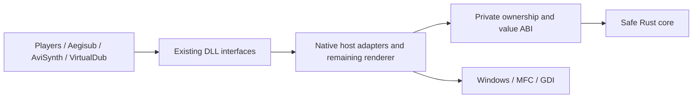

# Compatibility-first Rust migration

## Contract

The behavioral reference is pinterf/xy-VSFilter commit
`4911cacb102bc0cbd41449793e54473265b04e62`. All functionality remains in scope.
The target is a drop-in replacement in players, Aegisub and other existing hosts,
with bit-identical output. The repository itself defines ASS behavior; another
renderer or format description must not override it. Memory safety is the reason
for migration. A performance regression is acceptable. No deliberate semantic
cleanup is part of a port.

Preserve deterministic malformed-input results, parser recovery, byte and code
unit handling, integer truncation, timing boundaries, rounding, font metrics,
rendering order, caches' visible effects, and state across seeks. Keep externally
observable settings, interfaces, exports, identity and calling conventions.
Stable behavior implemented with unsafe C++ may need safe emulation in Rust.
Do not reproduce memory corruption. Crashes, hangs and unstable output are
unresolved reference outcomes requiring investigation, never matching results.

## What has been implemented

* A dependency-free Cargo workspace. `rust/compat` forbids unsafe Rust and uses
  only `core`/`alloc`. The production Windows static library uses `native-runtime`
  to avoid pulling in Rust std's newer Windows dependencies. A small allocator
  adapter uses the DLL's existing CRT `_aligned_malloc`/`_aligned_free` pair.
* A safe port of `CTextFile::NextChar`, including its nonstandard UTF-8 behavior,
  raw UTF-16 code units, error statuses and cursor movement.
* Safe Rust ownership of the text reader's 4 KB buffer and decoded line, including
  refill/compaction, CR/LF handling, surrogate output, malformed-input fallback
  and EOF cursor state. Native file reads, seeks, BOM detection and logging remain
  in a small adapter. The adapter borrows the fixed Rust buffer only during a
  native read; no Rust frame is active when an MFC exception can occur. The
  extracted C++ oracle now checks **37,008 file scenarios / 1,396,467 line/seek
  comparisons**, including **6,096 injected read exceptions**, short reads,
  repeated EOF, reopening, encoding changes and diagnostic ordering. This new
  component passed local fatal ASan/UBSan, Miri and all four portable CI jobs.
  Candidate `022da3c4` also passed [Windows x86/x64 renderer validation](https://github.com/CoffeeFlux/xy-VSFilter/actions/runs/38425799685)
  on the expanded 210-case corpus plus 32 mutations, with matching exports and
  no added imports/changed platform headers for all three DLLs.
* Safe Rust font-attachment decoding, preserving byte truncation of arbitrary
  UTF-16 units, invalid lengths and short tails. The same opt-in build property
  enables this component. GDI font installation remains native.
* Safe Rust ASS command/parameter tokenization. Empty tags, non-nesting
  parentheses, comma/backslash recovery and raw code units are retained. Native
  `iswspace` supplies classifications to preserve CRT/locale behavior.
* Safe Rust drawing command state and temporary path storage. Empty moves,
  incomplete Bezier groups, spline rollback/fallthrough, closure and validity
  checks follow `CPolygon::ParseStr`. Native CString tokenization, `GetPOINT`/
  `wcstod`, numeric tracing, scaling and downstream rasterization remain intact.
  The extracted command-state oracle passed **343,183** comparisons of path
  types, coordinates, validity, cache bypass and point-request order, using
  identical supplied token/point results. Local fatal ASan/UBSan passed; full
  Windows validation of this new component is pending.
* Value-only internal C ABIs for the character and attachment decoders. The ASS lexer
  has a separate, documented ownership boundary: it borrows two bounded input
  arrays during scanning, retains only integer spans, and returns an opaque owner
  whose destructor runs in Rust. A noncopyable C++ RAII wrapper owns it. No Rust
  allocation is freed by C++, and query results contain only integers.
  The buffered reader has its own noncopyable owner and a documented, bounded
  mutable borrow for native file I/O; its line storage stays private to Rust.
* An opt-in `RustTextDecoder=true` native build property. The original public DLL
  interfaces are retained. The default build still uses the original C++ code.
* A differential test that extracts the exact original method and UTF-8 helper
  header from the pinned Git commit, compiles them, and calls the real Rust ABI.
  It checks **85,992,064** cases: return values AND consumed bytes. This includes
  all 256 possibilities for each UTF-8 tail byte, not merely valid Unicode.
  A second oracle extracts the original `LoadFont` decoding block and compares
  **17,371,137** cases against the candidate block through its actual C ABI.
  The ASS lexer oracle extracts its original scanning block unchanged and
  compares commands, parameters, ordering and empty tags; it uses real ATL
  strings on Windows and storage stand-ins elsewhere. The local macOS run checks
  **2,793,355** cases with fatal ASan/UBSan; counts vary with available CRT locales.
* An isolated-process CSRI comparison harness, an exact-byte corpus generator,
  PE export/ordinal comparison, and a gate against added normal/delay imports or
  changed declared OS/subsystem requirements.
* CI for macOS, Linux and Windows x86/x64 leaf/bridge tests. These jobs do not
  build or validate the complete legacy renderer.
* A separate Windows renderer workflow builds all three native DLLs
  from separate pinned-reference and candidate checkouts, compare exports, and
  run the real CSRI corpus. See Actions for the latest result; a build failure or
  incomplete run is not compatibility evidence. Candidate `7c45fc12`, containing
  all three components and the CRT-only runtime, passed on **Windows x86 and
  x64**: all three DLL export tables match and no normal/delay imports were added.
  Each architecture passed **186 CSRI cases / 1,758 frames**, including successful
  embedded-font controls, plus two mutation campaigns: **32 cases / 224 frames**
  and **256 cases / 1,792 frames** with different seeds. [Regular run](https://github.com/CoffeeFlux/xy-VSFilter/actions/runs/38362034452),
  [larger mutation run](https://github.com/CoffeeFlux/xy-VSFilter/actions/runs/38362090425).
  [Compatibility evidence](compatibility-evidence.json) preserves counts,
  toolchains, report hashes and the six DLL hashes for each architecture/run.
  All four portable jobs and Miri also [passed](https://github.com/CoffeeFlux/xy-VSFilter/actions/runs/38362034486).

The migration is an initial set of components and validation tools, not a finished
safe renderer. The rest of the native parsing, font handling, rendering,
other buffer management and host integration remains C++. There is no whole-renderer
compatibility or memory-safety claim yet.

## Migration shape

Keep the existing native projects and host adapters while replacing internals
behind a private C ABI. Consumers continue loading the same DLLs and public
interfaces. Rust modules follow responsibilities (`text`, `font`, `ass_tags`);
they do not need to reproduce every C++ class or directory. Retain a small
reviewable native change per component and a pinned, independently built oracle.



Portable algorithms and their differential tests can be developed on macOS.
Windows remains necessary for MFC, COM, GDI, DLL linking and actual host behavior;
the new CI already handles paired builds and CSRI rendering remotely. The local
Windows handoff is primarily for real application integration, debugger work,
and environments such as Windows 7 or specific font/locale/CPU configurations.

For each next component: isolate its real C++ code, capture its state and error
semantics, port into bounded Rust storage, compare at the internal boundary,
then compare complete DLL output. Move ownership of untrusted buffers into Rust
as components grow. Tiny arithmetic ports alone do not remove native lifetime
hazards. Keep production opt-in until wider host and malformed-input evidence
supports changing the default.

## A concrete quirk already preserved

The UTF-8 branch of `NextChar` only validates the leading byte and available
length. It masks subsequent bytes with `0x3f` even when they are not continuation
bytes. For example, `c2 41` produces `0x81`, `ed a0 80` produces the raw surrogate
`0xd800`, and `f4 bf bf bf` produces `0x13ffff`. The latter is handled later by
`ReadLine`, not by this decoder. A rejected lead consumes one byte; an incomplete
sequence consumes none. Rust strings or `char` would lose this behavior.

The attachment decoder also accepts code units outside the usual encoded-font
alphabet: it subtracts 33, truncates to a byte, and then masks bits. The port
preserves that behavior. Its Rust bulk API validates the output slice before
writing; the temporary C++ adapter retains allocation and packs four input units
at a time into a value-only ABI. The native adapter's loop bounds still require
review; no pointer is dereferenced inside Rust.

## Local validation

Python 3.10+, a C++ compiler, Git history containing the pinned commit, and Rust
are sufficient. The CI toolchain is Rust 1.85.0; local reports record the actual
compiler. No Cargo registry downloads are needed by the workspace.

```sh
cargo test --workspace --locked --offline
cargo clippy --workspace --all-targets --locked --offline -- -D warnings
cargo fmt --all --check
python3 tools/compat/check_decoder.py --sanitize
python3 -m unittest discover -s tools/compat -p 'test_*.py' -v
python3 tools/compat/make_corpus.py --check
```

The decoder report goes to `artifacts/decoder/<target>/report.json` and records
the reference commit, source hashes, compiler and result. The native tests
extract the original algorithm without modifying it; the only test stand-in is
the class shell around that method. The ASan/UBSan run instruments the C++ side;
it does not instrument the Rust static library. Safe Rust is enforced in the
core by a compiler lint. The ASS lexer, text reader and drawing FFI owners and the production CRT
allocator contain unsafe Rust, for constructing borrowed slices,
querying/releasing owned results, lending the fixed read buffer to native I/O,
and allocating/deallocating aligned storage.
Every unsafe block states its caller contract. The native caller copies its
inputs into typed vectors and bounds output spans by the original string length.
Miri checks the Rust-side ownership lifecycle in a separate CI job. Windows unit
tests also check the CRT allocator's alignment, zeroing and reallocation. Native
out-of-memory behavior and concurrent changes to the process locale have not
been established as compatibility guarantees.

The same command also compares the text-reader operations: **37,008
file scenarios and 1,396,467 line/seek comparisons**, including **6,096 injected
read exceptions**. It compares diagnostics, native read requests, cursor/count,
encoding and output, including retries after a read writes a byte then throws. Original and candidate BOM
detection, refill, line handling, logical positions and seeking are extracted
from their actual source files; only MFC's underlying file reads/seeks are replaced
by an in-memory test file. This exercises malformed sequences around 4096-byte
boundaries and encoding fallback. The complete MFC/Windows file path still needs
native integration coverage.

Harness tests compile a deliberately fake native CSRI library, exercise the real
ctypes ABI and subprocess machinery, and inject byte changes, crashes, hangs,
rejections and buffer overwrites. Passing these tests validates the harness,
not VSFilter's output.

## Windows handoff

The workflow `.github/workflows/native-compat.yml` is the executable build recipe
already used on Windows runners. It pins YASM and its required VC2010 runtime
with checksums. Use it when reproducing the setup locally; installing a newer
Visual C++ runtime alone does not provide `MSVCR100.dll` for that assembler.

Once the prerequisites below are installed, the combined runner builds both
trees, checks exports/imports, and runs the smoke, corpus and mutation comparisons:

```powershell
git worktree add --detach ..\xy-VSFilter-reference 4911cacb102bc0cbd41449793e54473265b04e62
pwsh -File tools/compat/run_native_comparison.ps1 -Platform x64 -Baseline ..\xy-VSFilter-reference -MutationCount 32
# Run from an x86 Native Tools prompt with x86 Python:
pwsh -File tools/compat/run_native_comparison.ps1 -Platform Win32 -Baseline ..\xy-VSFilter-reference -MutationCount 32
```

Use PowerShell 7 (`pwsh`) for the combined runner. Evidence goes to
`artifacts/native/x64` and `artifacts/native/Win32`; an existing destination is
rejected. For subsequent runs supply a new `-Output` directory. Build reports
record both commits, toolchain versions, dirty-tree status and the tracked-source
patch. A dirty/untracked working tree is not established by the commit ID alone;
commit source changes before producing release evidence. CI uploads reports,
build logs and all three reference/candidate DLLs. To replay downloaded mutation
artifacts, restore their `candidate/artifacts/native/...` tree under this checkout's
`artifacts/native/...`, preserving the manifest's relative fixture paths.

1. Clone `https://github.com/CoffeeFlux/xy-VSFilter.git`, fetch all history, and
   check out `rust/compatibility-foundation`.
2. Use separate baseline and candidate worktrees/build directories. The baseline
   must be the pinned commit above, without the Rust branch's code changes.
   Use the same Visual Studio toolset, SDK, Release configuration, architecture,
   Windows installation, fonts, locale and settings for each pair. Preserve the
   binaries and record their hashes. Do not mix x86 and x64 binaries.
3. Install Visual Studio C++ build tools including MFC/ATL, the Windows SDK,
   and the YASM integration needed by the original projects. The existing
   `build_vsfilter.sh` and `.github/workflows/build.yml` document the historical
   VS2019 build; `src/configuration.props` also selects v143 for VS2022. The
   legacy workflow uses old Actions/runner versions, so don't assume it still
   works unchanged. Restore a baseline build before interpreting port failures.
4. Install Rust's MSVC targets:

   ```powershell
   rustup target add x86_64-pc-windows-msvc i686-pc-windows-msvc
   ```

5. In the appropriate VS Native Tools prompt, run the leaf differential test:

   ```powershell
   python tools/compat/check_decoder.py --target x86_64-pc-windows-msvc
   # Repeat in an x86 compiler environment:
   python tools/compat/check_decoder.py --target i686-pc-windows-msvc
   ```

6. Build the candidate Rust library, then rebuild the native solution with the
   experimental property. Start with x64; repeat for Win32:

   ```powershell
   powershell -File tools/compat/build_rust_windows.ps1 -Platform x64
   msbuild VSFilter.sln /m /t:Rebuild /p:Configuration=Release /p:Platform=x64 /p:RustTextDecoder=true
   ```

   The Rust library uses a static CRT to match `/MT`. Debug integration is
   intentionally rejected until its runtime configuration is validated. The
   build script prints `native-static-libs`; check the list against the native
   link configuration when changing Rust versions. Rebuild all dependent native
   libraries after changing the property; existing objects are not trustworthy
   when switching implementations.

   `src/common.props` targets Windows 7 (`WINVER=0x0601`). Modern Rust's regular
   Windows std targets require Windows 10, so production uses `core`/`alloc` and
   the existing native CRT instead. The C++ bridge requires a link marker from
   this configuration, rejecting an accidentally linked std build. The native
   workflow rejects added imports and changed PE OS/subsystem fields. These
   checks do **not** establish Windows 7 or older-CPU support: run the binaries
   on those environments before release, checking code generation and dynamic
   API loading too. [Rust's Windows baseline change](https://blog.rust-lang.org/2024/02/26/Windows-7/),
   [MSVC aligned-allocation contract](https://learn.microsoft.com/en-us/cpp/c-runtime-library/reference/aligned-malloc).

7. Compare exports for every shipped DLL, including the consumer when built:

   ```powershell
   python tools/compat/pe_exports.py C:\baseline\VSFilter.dll C:\candidate\VSFilter.dll
   python tools/compat/pe_exports.py C:\baseline\XySubFilter.dll C:\candidate\XySubFilter.dll
   ```

8. Run original-vs-original first, then original-vs-candidate. Python must have
   the same architecture as the DLL. Output directories must be new:

   ```powershell
   python tools/compat/csri_compare.py --reference C:\baseline\VSFilter.dll --candidate C:\baseline\VSFilter.dll --output artifacts\reference-x64 --environment-label "Win-build/toolset/fonts/settings"
   python tools/compat/csri_compare.py --reference C:\baseline\VSFilter.dll --candidate C:\candidate\VSFilter.dll --output artifacts\candidate-x64 --environment-label "Win-build/toolset/fonts/settings"
   ```

9. Investigate every mismatch or unstable reference before enabling the port by
   default. Smoke-test actual Aegisub loading and rendering, DirectShow playback,
   AviSynth and VirtualDub. Add automated host-specific coverage as those seams
   become accessible. CSRI alone cannot validate the complete product.

## CSRI corpus and evidence

`test/compat/cases.json` contains 240 cases: both file and memory
loading for 34 existing ASS samples and 85 generated samples, plus geometry and
stride cases. Generated cases include malformed tags, duplicate tags, malformed
UTF-8, unpaired UTF-16, embedded NUL, CR/LF differences, missing final newlines
and the original 4096-byte refill boundary. `.gitattributes` prevents checkout
from changing any test bytes. Font cases include invalid encoded lengths/raw
UTF-16 units and a valid, pinned Abel font attachment. The unmodified font and
its SIL Open Font License are in `test/compat/fonts`; `source.json` records its
origin and hashes. Attached/attachment-free controls must produce different
pixels in both builds, establishing that loading the font affects rendering.
Run those controls on a machine without Abel already installed. A control failure
is explicit and cannot pass merely because both renderers use the same fallback.
Run `make_corpus.py` to regenerate, or `--check`
to verify. Do not rewrite old fixtures to make a test pass.

Timestamps sample the first recognizable event's boundaries, midpoint and
backward seeks. This is deliberately a starter corpus: it does not cover all
events, animations, historical issue-specific timestamps, formats or host paths.
Sampling times are configuration, not a specification of how ASS is parsed.
Grow coverage using real scripts and minimized mismatch reproducers.

Each case gets fresh reference processes (at least two) and a fresh candidate
process, but retains one renderer instance for its entire timestamp sequence.
The complete destination allocation, including row padding and the fourth byte,
is initialized identically before each render and compared without tolerance.
Frame output is compared byte-for-byte; canaries detect nearby writes outside
the destination. Canaries are not a replacement for a sanitizer.

Reports include DLL and corpus hashes, case definitions, exact IEEE timestamp
bits, frame hashes, rejection statuses and first differing byte offsets. Failed
cases retain raw frames. Equal cases drop raw frames by default to save space;
`--keep-equal-frames` preserves all of them. Reports are checkpointed as cases
finish and only marked complete at the end. Crashes, timeouts, guard corruption,
harness errors and unstable reference output fail the run. A run with no rendered
frames cannot pass. Stable matching open rejections are recorded explicitly.

On Windows, reports also capture exported names/ordinals, OS, pointer width,
locale/code pages, hashes of files in system/per-user font directories, and a
read-only snapshot of `HKCU\Software\Gabest`. A change in that environment during
the run fails the comparison. Font registrations outside those directories,
system rasterizer versions, external files, host state and private fonts need
additional provenance as coverage grows. Keep baseline/candidate `.properties`
and localization sidecars identical and document them in the environment label.
The recorded reference commit identifies the intended source; the harness cannot
prove which source produced an arbitrary DLL. Archive build logs with binaries.

One source-level CSRI trap: `csri_request_fmt` accepts BGR32, BGR24, YUY2 and
YV12, but `csri_render` implements only BGR32 and otherwise displays a dialog and
enters invalid arithmetic. The harness records format-query results but only
renders BGR32. This mismatch is recorded, not silently "corrected" or mistaken
for implemented pixel-format coverage.

## Mutation runs and mismatch reduction

`mutate_corpus.py` adds deterministic byte edits to combinations of ASS tags,
with UTF-8/BOM/raw UTF-16 variants. It records the seed, generator version,
operations and hashes. This is a bounded mutation campaign, not coverage-guided
fuzzing or exhaustive malformed-input coverage. Native CI adds 32 cases with
seed 12345 after the checked-in corpus; manual workflow runs can select another
seed and count. A reference crash remains a failure to investigate.

```powershell
python tools/compat/mutate_corpus.py --seed 12345 --count 64 --output artifacts\mutations
python tools/compat/csri_compare.py --reference C:\baseline\VSFilter.dll --candidate C:\candidate\VSFilter.dll --cases artifacts\mutations\cases.json --output artifacts\mutation-results --timeout 10 --environment-label "local Windows mutation run"
```

For a mismatch whose reference runs agree, reduce the exact input bytes without
rewriting the source fixture:

```powershell
python tools/compat/reduce_case.py --reference C:\baseline\VSFilter.dll --candidate C:\candidate\VSFilter.dll --case artifacts\mutation-results\case-00000\case.json --output artifacts\reduced --max-attempts 100
```

Every trial repeats the reference and checks the failure category. A crash,
timeout, guard violation or unstable reference cannot replace a pixel mismatch.
The reducer checkpoints the best input, case manifest, binary hashes and trial
results, and retains initial/best frame evidence. Its report distinguishes
finishing the reduction from exhausting the attempt budget. Re-run the final
`cases.json`, inspect its raw bytes, then add it as a regression fixture. The
reducer does not handle unresolved native crashes yet; keep those original inputs
for a Windows debugger/sanitizer run. Native harness tests inject a real byte
mismatch and verify reduction, while rejecting equal outputs and crashes.

## Coverage map and remaining migration

| Surface/subsystem | Reference locations | Required evidence still missing |
| --- | --- | --- |
| DirectShow/COM, registration, property pages, autoload | `DirectVobSubFilterDll.cpp`, `DirectVobSub*.h`, `auto_load_helper.cpp` | CLSIDs/IIDs, vtables, HRESULTs, refcounts, graph negotiation, threading, registration/unload, player tests |
| XySubFilter and consumer | `xy_sub_filter*.cpp`, `include/SubRenderIntf.h`, `XySubRenderIntf.h` | Provider/consumer negotiation, frame ownership, options and lifecycle |
| Aegisub/CSRI | `csri.h`, `csriapi.cpp` | Broader DLL corpus, open flags/extensions, longer lifecycle sequences and real Aegisub integration; the three-component corpus passes x86/x64 |
| AviSynth | `plugins.cpp`, `vfr.cpp` | Exact `VobSub`, `TextSub`, `TextSubSwapUV`, `MaskSub` signatures/defaults, frame properties, timing, pixel formats, MT behavior |
| VirtualDub | `plugins.cpp`, bundled SDK headers | Export calling conventions, filter negotiation, scripting, RGB orientation, lifecycle |
| Text formats | `STS.cpp`, `TextFile.cpp`, `RealTextParser.cpp`, `USFSubtitles.cpp`, `libssf` | SSA/ASS, SubRip variants, SubViewer, MicroDVD, SAMI, WebVTT, VPlayer, XombieSub, USF, MPL2, RealText and SSF parsing/recovery |
| Bitmap subtitles | `VobSub*`, `HdmvSub*`, `DVBSub*`, `CompositionObject*`, `CCDecoder*` | DVD/VobSub, PGS/SUP, DVB, closed captions, embedded stream and external file behavior |
| Layout/rendering | `RTS.cpp`, `Rasterizer.cpp`, caches, overlay/clip code | Every tag's recovery and interaction, drawings, clipping, transforms, karaoke, blur/border/shadow, GDI/font metrics and fallback |
| Compositing/color | `subpic`, SIMD/assembly, conversion tables | All RGB/YUV formats, high bit depths, interlace/subsampling, pitch/orientation, alpha and rounding |
| Supporting behavior | `dsutil`, `decss`, vendored libraries, settings | Encodings, code pages, font attachments, file/network access, archive inputs, persistence and remaining unsafe dependencies |

Continue portable migration here while Windows CI checks each native bridge.
Local Windows work includes actual Aegisub/player loading and the host coverage
above. Useful next port boundaries include field/numeric parsing in `STS.cpp`
and drawing-path parsing in `CPolygon`. Numeric conversion
must preserve the Windows CRT's overflow, locale, end-pointer and float-rounding
behavior; substituting Rust's string parsers is not justified. The drawing code
also has non-obvious recovery and truncation behavior to capture before porting.

Concrete boundaries that can be developed on macOS, with Windows CI supplying
the native oracle where needed:

| Next boundary | Portable work | Native behavior to retain and compare |
| --- | --- | --- |
| `STS.cpp` field splitting and numeric parsing | Raw UTF-16 fields, cursor/mutation state, error recovery | `GetStr` leaves the last undelimited field in the buffer; `TryNextStr` trims only ASCII space and mutates a separator to NUL. Keep CRT numeric conversion until overflow, locale, end-pointer and rounding results are captured. |
| `RTS.cpp` `CPolygon::ParseStr` | Command recovery, path storage, spline state and closure | `SpanIncluding`'s return value is ignored; commands split inside arbitrary text; `s` falls through to `p`; the apparent Bezier truncation uses an incremented counter and must not be "fixed." Keep `wcstod` and float-to-LONG conversion at the native boundary initially. |
| `CompositionObject.cpp` bitmap run decoding | Bounded byte/bit readers, RLE state, emitted rectangles | Capture truncated-stream behavior, signed-short coordinate wrapping, palette state and transparent runs. Keep native palette conversion/compositing until those stages have separate exact-byte oracles. Uninitialized allocation tails are unresolved behavior, not a portable specification. |
| `xy_filter.cpp` and raster/compositing kernels | Safe slice ownership and scalar arithmetic implementations | Capture each active SIMD path's operation order, padding, overlap and rounding. Scalar C++ output alone does not establish equality with the SIMD implementation used by a DLL. |

These are code boundaries, not promises that a finite corpus covers every quirk.
Each replacement needs the same sequence used for the buffered reader: extract
the reference code, compare state and errors locally, then build both Windows
architectures and compare actual output before expanding its use.

Preserve bytes and UTF-16 units until the original code itself converts them.
Keep GDI font behavior while porting surrounding algorithms. Rasterization and
compositing can start with scalar Rust implementations if their exact arithmetic
matches the original SIMD/assembly. Third-party native code also belongs in the
memory-safety inventory; converting first-party code alone does not establish a
safe Aegisub dependency. Use larger mutation campaigns, coverage-guided fuzzing
and minimized differential cases to discover the long tail, with a pinned
reference and isolated workers for every experiment.
